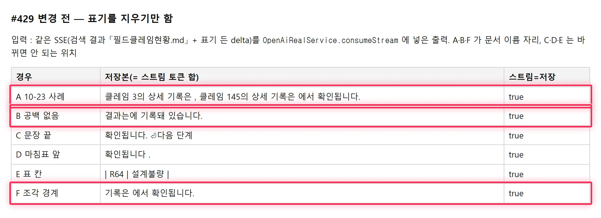
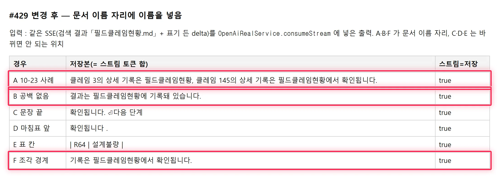

## 작업 리포트 — #429 인용 표기를 지운 자리의 빈칸

### 원인
- `CitationMarkupFilter` 는 표기를 지우기만 해서, 모델이 표기를 문서 이름 자리에 넣으면 빈칸이 남았다. #372 는 지시문으로만 막아 빈도를 줄였다
- 문서 이름은 표기보다 먼저 손에 있다 — `file_search_call` 결과(`output_item.done`)가 본문 delta 보다 먼저 온다. 표기의 `turnNfileM` 으로 이름을 찾을 수 있다

### 변경
- 필터가 표기 뒤 공백을 첫 글자가 올 때까지 보류하고, **앞이 「은 · 는 · 을 · 를」(+공백)이며 뒤가 쉼표 · 「에 · 의 · 와 · 과 · 을 · 를」** 이면 확장자 뺀 문서 이름을 넣는다
- 그 밖의 위치(문장 끝 · 마침표 앞 · 표 칸)와 이름으로 안 풀리는 참조는 지금처럼 지우기만 한다. 스트림 토큰 합 = 저장본 유지
- 리뷰 반영 : 명사 끝 · 단어 첫 글자로 흔한 「이 · 가 · 도 · 로 · 과」를 판정에서 뺌(「점검 결과 <표기> 이상 없음」 오탐 방지) · 연속 표기 공백 · 점 든 파일명
- 문서 : `live-integration.md` 「인용 표기 대응 규칙」(v1.9) · `backend.md` · CHANGELOG. 백엔드 하한 338 → 347

### 전후 비교 — 같은 SSE 입력을 `consumeStream` 에 넣은 출력

| 경우 | 변경 전 | 변경 후 |
| --- | --- | --- |
| A 10-23 운영 사례 | 기록은  , … 기록은  에서 확인됩니다. | 기록은 **필드클레임현황**, … 기록은 **필드클레임현황**에서 확인됩니다. |
| B 공백 없음 | 결과는에 기록돼 있습니다. | 결과는 **필드클레임현황**에 기록돼 있습니다. |
| C 문장 끝 · D 마침표 앞 · E 표 칸 | (지움) | **변경 전과 같음** |
| F 조각 경계 | 기록은  에서 확인됩니다. | 기록은 **필드클레임현황**에서 확인됩니다. |

변경 전

변경 후 (박스 = 바뀐 경우)

### 검증
- `CitationMarkupFilterTest` 16건(신규 9) 통과 — 신규 테스트는 변경 전 코드에서 컴파일 실패(새 API)이고, 동작 차이는 위 측정 출력
- `scripts/check-all.sh` : 통과 — 백엔드 347건(하한 347) · 프론트 206건 · 이미지 빌드 · 문서 검사(섹션 참조 1건을 고친 뒤 재실행). 로컬에 도구가 없어 shellcheck · gitleaks · trivy 는 건너뜀(CI 에서 돈다)
- 운영 재현은 확률적(0.1%)이라 배포 후 같은 문항 반복으로는 확인하지 않는다. 원자료 iCloud QA `results/2026-10-23-burn/`

원본 출력 : `.issue/429/evidence/{before,after}/probe.txt`
