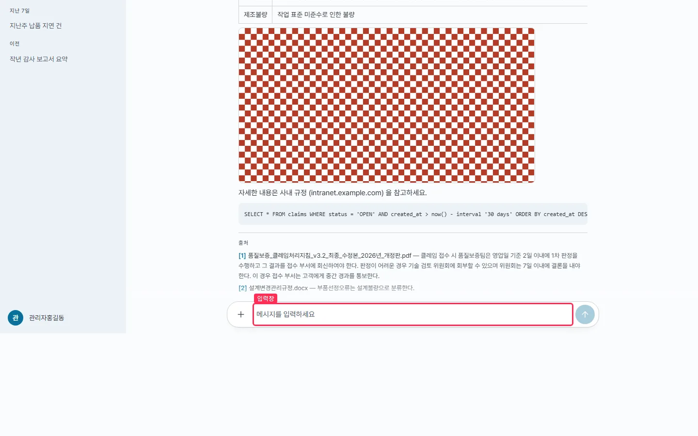
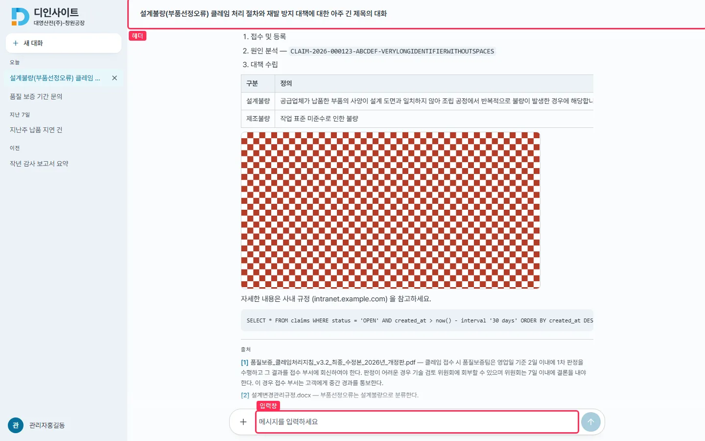
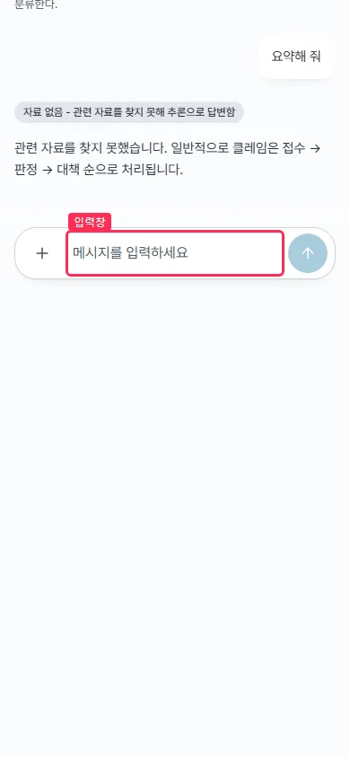
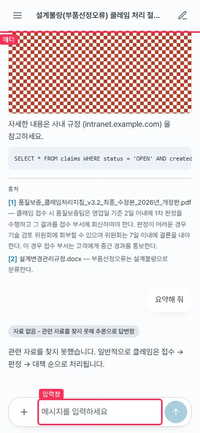

## #642 대화를 열면 화면 전체가 위로 밀림 — 전후 증거

브랜치 `fix/642-chat-scroll-shift` · 커밋 `41c6555`

### 원인

본문 스크롤 상자(`ChatPage.tsx` 의 `div.h-full.overflow-y-auto`)에 `relative` 가 없었다. 목록 끝의 낭독용 상태 줄(`sr-only` = `position:absolute`)이 이 상자를 기준으로 삼지 못하고 밖으로 나가 문서 높이를 늘렸다. 그 상태에서 `scrollIntoView` 가 html 까지 스크롤해 헤더가 화면 밖으로 나가고, 입력창이 화면 중간에 떴다.

### 수정

스크롤 상자에 `relative` 를 하나 더했다. 반응형 분기가 없는 클래스라 두 폭에 똑같이 적용된다. 회귀 테스트도 하나 더했다(jsdom 은 레이아웃이 없어 기준 상자 클래스만 단언하고, 밀림 자체는 아래 브라우저 측정으로 확인했다).

### 측정 (playwright, 목업 API · 같은 빌드 조건 · 대화 c1 을 열고 1.5초 뒤)

| 폭 | 지표 | 전 | 후 |
|---|---|---|---|
| 데스크톱 1440×900 | 문서 scrollTop | **212** | 0 |
| | 문서 높이 / 화면 높이 | 1310 / 900 | 900 / 900 |
| | 헤더 top | −212 | 0 |
| 모바일 390×844 | 문서 scrollTop | **521** | 0 |
| | 문서 높이 / 화면 높이 | 1365 / 844 | 844 / 844 |
| | 헤더 top | −521 | 0 |

원자료 : `before/measure.json` · `after/measure.json` · 캡처 스크립트 `cap642.mjs`

### 화면

박스는 헤더와 입력창이다. 「전」에는 헤더가 화면 밖에 있어 헤더 박스가 보이지 않는다.

| | 전 | 후 |
|---|---|---|
| 데스크톱 |  |  |
| 모바일 |  |  |

### 확인

- `npm run lint` 통과 · `npm test` 340 → 341 · `npm run build` 통과
