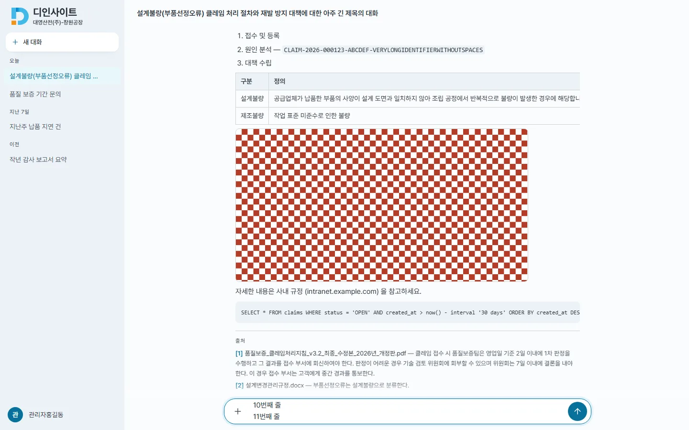
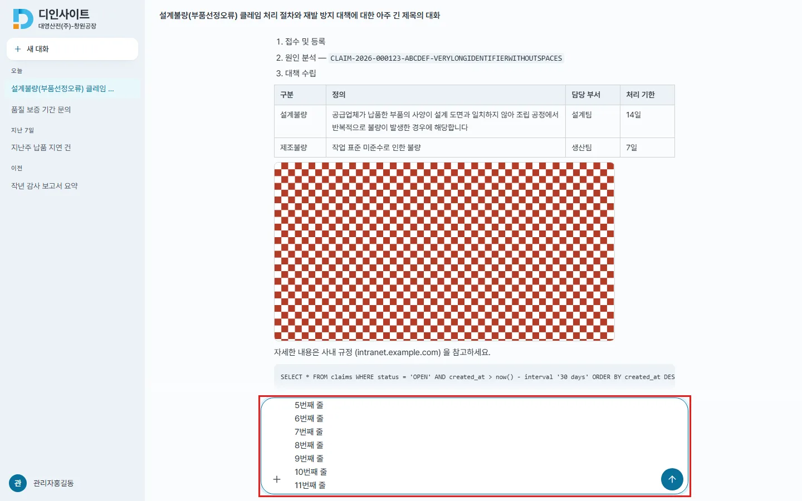
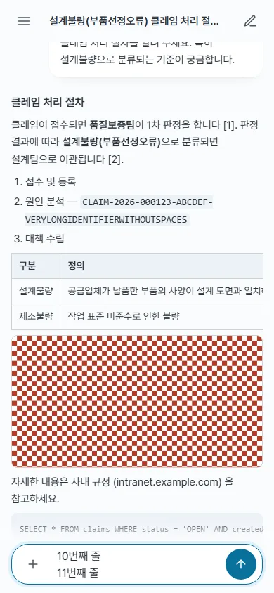
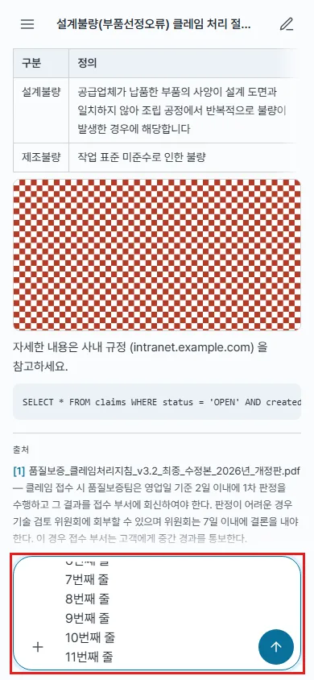
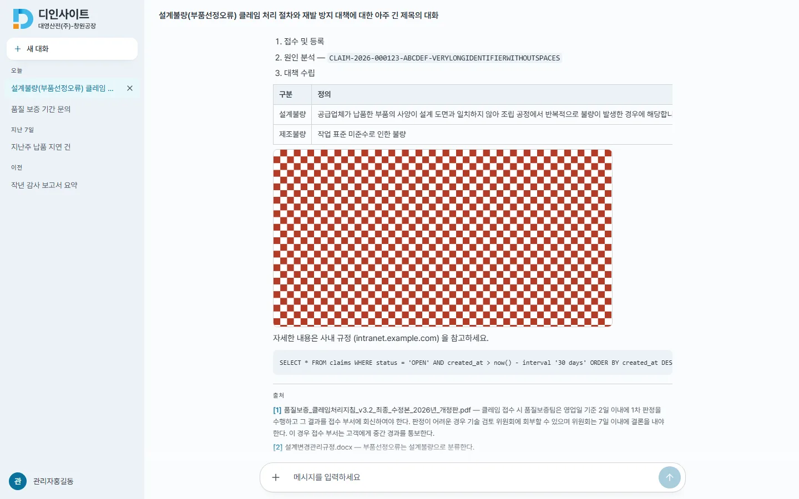
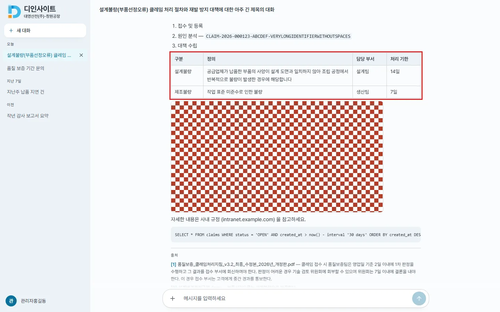
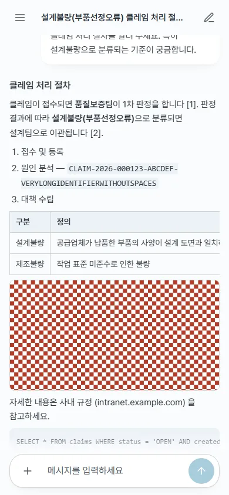
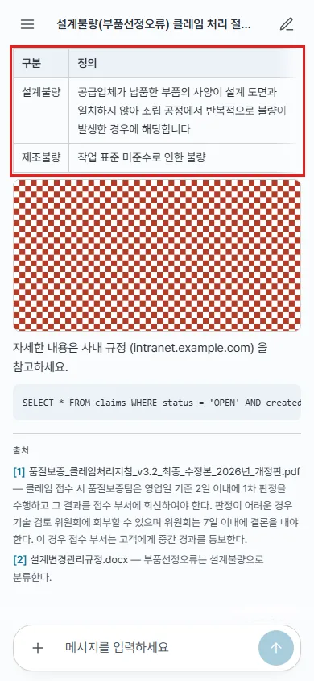

## #643 입력창 높이 · 답변 표 넘침 — 전후 증거

- 방식 : 변경 전후 커밋에서 각각 `vite build`(API = 목업) → playwright 로 같은 대화를 열어 **데스크톱 1440×900 · 모바일 390×844** 두 폭에서 측정 · 캡처(`cap.mjs`). 화면 밀림(#642)은 별도 이슈라 캡처 전에 문서 스크롤을 0 으로 되돌렸다
- 원자료 : `before/metrics.json` · `after/metrics.json`

### 측정

| 항목 | 데스크톱 전 → 후 | 모바일 전 → 후 |
|---|---|---|
| 입력창 5줄 입력 시 보이는 높이 | 40 → **136px** | 44 → **128px**(상한) |
| 입력창 11줄 | 40 → **160px**(상한, 안쪽 스크롤) | 44 → **128px** |
| 한 줄 높이 · 보내기 버튼 | 40 · 40 → 40 · 40 | 44 · 44 → 44 · 44 |
| 표 폭 / 상자 폭 | 891 / 720(넘침) → **720 / 720(넘침 0)** | 891 / 358 → 536 / 358(가로 스크롤 유지) |
| 긴 셀 행 높이 | 36(한 줄로 늘어 잘림) → 59 | 36 → **81** |
| 스크롤 상자 | tabIndex -1 · 이름 없음 → **0 · region 「표」** | 같음 |
| 넘침 페이드 | 없음 → 없음(넘치지 않음) | 없음 → **보임**(끝까지 스크롤하면 사라짐) |

### 입력창 — 5~11줄 입력

| | 전 | 후 |
|---|---|---|
| 데스크톱 |  |  |
| 모바일 |  |  |

### 답변 표

| | 전 | 후 |
|---|---|---|
| 데스크톱 |  |  |
| 모바일 |  |  |

### 변경

- `Composer.tsx` — textarea 에 `[field-sizing:content]`, 모르는 브라우저는 `useLayoutEffect` 에서 scrollHeight 로 높이. 상한 `max-h-32 md:max-h-40`(한 줄 44/40 · #218 조건 그대로)
- `Markdown.tsx` — th·td `max-w-[20rem]`(`w-max min-w-full` 유지 — 셀 하한을 주는 안은 모바일 행 309px 로 기각), 스크롤 상자 `TableScroll`(region · tabIndex 0 · 넘칠 때만 페이드, ResizeObserver 로 다시 잼)
- 테스트 340 → 346(Markdown 3 · Composer 3) · lint · build 통과
- 문서 : `frontend.md` 표 줄 · `design-system.md` 입력창 줄
