## #644 키보드 · 낭독기 접근성 — 전후 증거

**측정** : 목업 API 로 전후 빌드를 띄워 playwright 로 키보드만 조작(`k644.mjs`, 데스크톱 1440×900 · 모바일 390×844). 원자료 `before/keyboard-probe.json` · `after/keyboard-probe.json`.
「뒤 화면 도달」은 Tab 이 모달 · 드로어 바깥의 요소에 닿은 횟수다(BODY = 마지막 요소 다음 브라우저 UI 로 나가는 정상 순환은 세지 않음).

| 폭 | 항목 | before | after |
|---|---|---|---|
| desktop | 업로드 칸 Tab 도달 | False | True |
| desktop | 삭제 버튼 이름 | 삭제 · 삭제 · 삭제 | 클레임처리지침.pdf 삭제 · 설계변경관리규정.docx 삭제 · 스캔본.pdf 삭제 |
| desktop | confirm : Tab 6번 중 뒤 화면 도달 | 4 | 0 |
| desktop | confirm : 닫은 뒤 포커스 | button「삭제」 | button「클레임처리지침.pdf 삭제」 |
| desktop | issued : Tab 4번 중 뒤 화면 도달 | 3 | 0 |
| desktop | issued : 닫은 뒤 포커스 | input「」 | button「김철수 비밀번호 초기화」 |
| desktop | lightbox : Tab 6번 중 뒤 화면 도달 | 4 | 0 |
| desktop | lightbox : 닫은 뒤 포커스 | button「클레임 처리 절차」 | button「첨부 이미지 1/2 확대」 |
| mobile | 업로드 칸 Tab 도달 | False | True |
| mobile | 삭제 버튼 이름 | 삭제 · 삭제 · 삭제 | 클레임처리지침.pdf 삭제 · 설계변경관리규정.docx 삭제 · 스캔본.pdf 삭제 |
| mobile | confirm : Tab 6번 중 뒤 화면 도달 | 4 | 0 |
| mobile | confirm : 닫은 뒤 포커스 | button「삭제」 | button「클레임처리지침.pdf 삭제」 |
| mobile | issued : Tab 4번 중 뒤 화면 도달 | 3 | 0 |
| mobile | issued : 닫은 뒤 포커스 | input「」 | button「김철수 비밀번호 초기화」 |
| mobile | lightbox : Tab 6번 중 뒤 화면 도달 | 4 | 0 |
| mobile | lightbox : 닫은 뒤 포커스 | button「클레임 처리 절차」 | button「첨부 이미지 1/2 확대」 |
| mobile | 드로어 dialog | 0 | [{'label': '대화 목록', 'modal': 'true'}] |
| mobile | 드로어 열린 뒤 포커스 | button「대화 목록 열기」 | button「새 대화」 ∈dialog(named) |
| mobile | 드로어 Esc 뒤 열림 · 포커스 | 1 · button「새 대화」 | 0 · button「대화 목록 열기」 |

**스트리밍 aria-busy · reduced-motion** 은 화면 캡처로 드러나지 않아 단위 테스트로 잠갔다(`MessageList.test.tsx`). 탐침의 완료된 대화에서 log `aria-busy` = before 없음(null) → after `false`.

**겉모양** : 전후 캡처 픽셀 대조 — 바뀐 곳은 의도한 두 곳뿐이다 : 업로드 칸 키보드 포커스 외곽선(두 폭), 모바일 드로어를 열면 포커스가 「새 대화」로 들어가 외곽선이 보임. 나머지 화면(확인 창 · 발급 창 · 확대 보기 · 채팅 · 문서 목록)은 두 폭 모두 픽셀까지 같다. after 의 빨간 박스는 해당 컴포넌트 위치다.

| 화면 | before | after |
|---|---|---|
| desktop admin-docs-upload-focus | 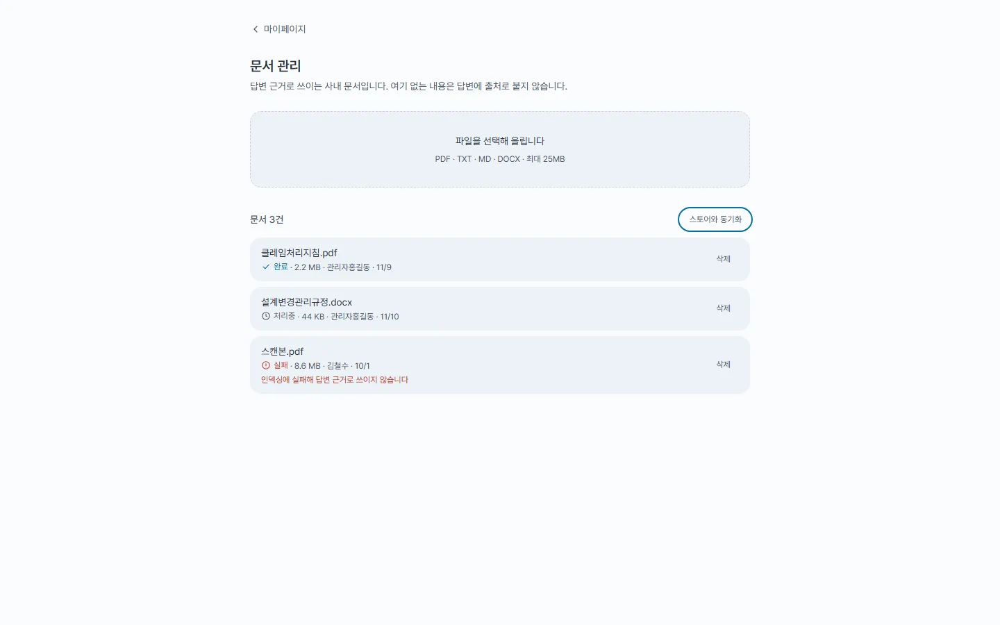 | 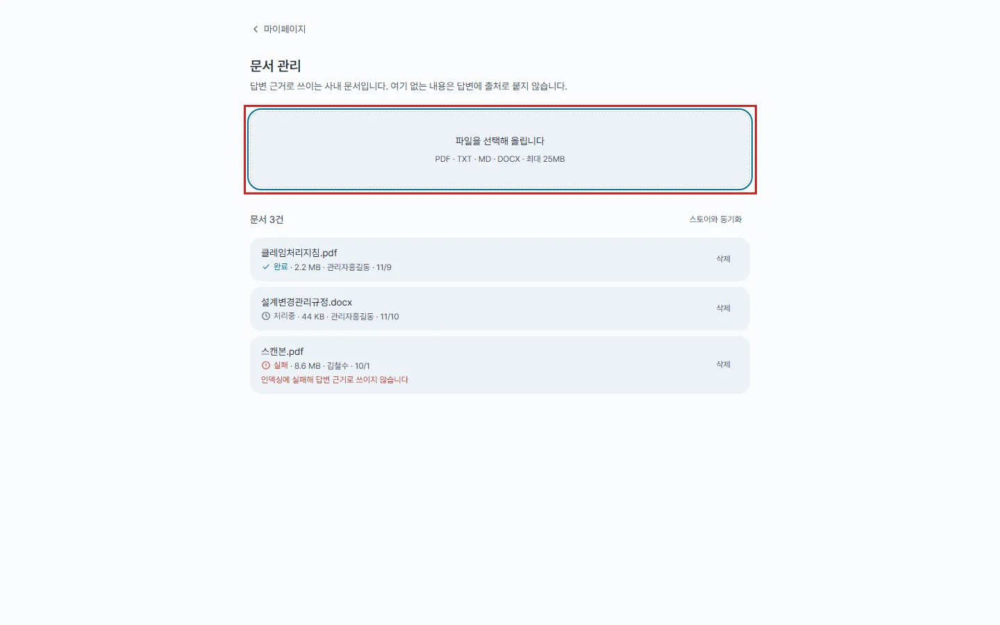 |
| mobile admin-docs-upload-focus | 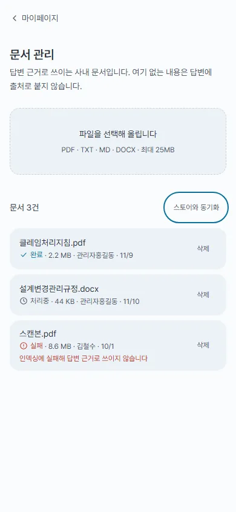 | 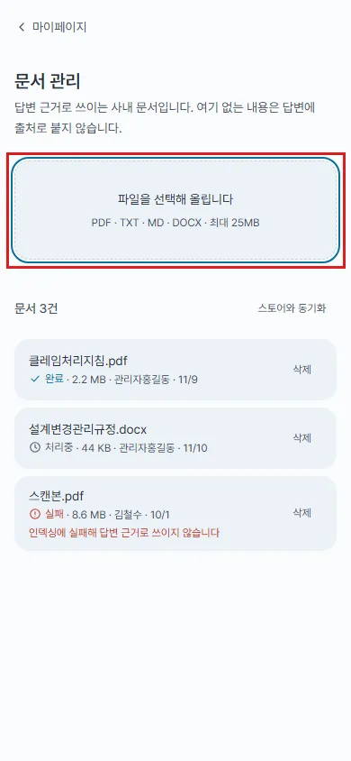 |
| desktop confirm | 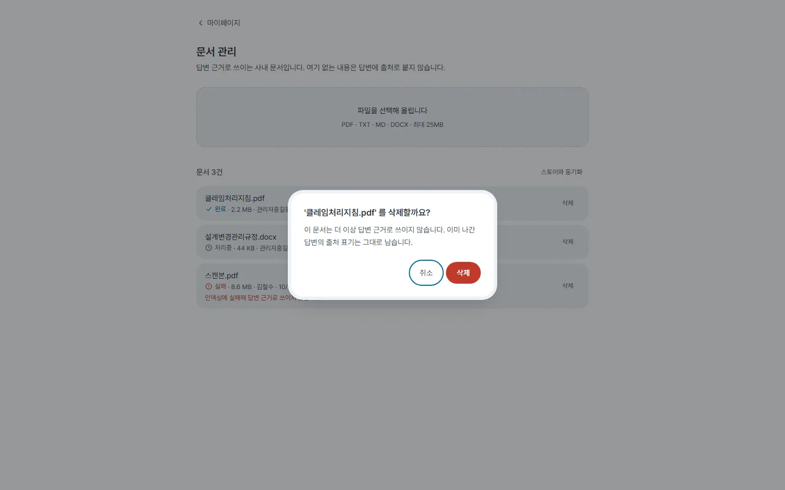 | 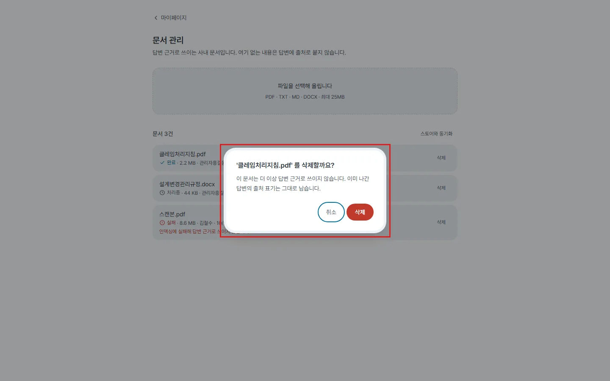 |
| mobile confirm |  | 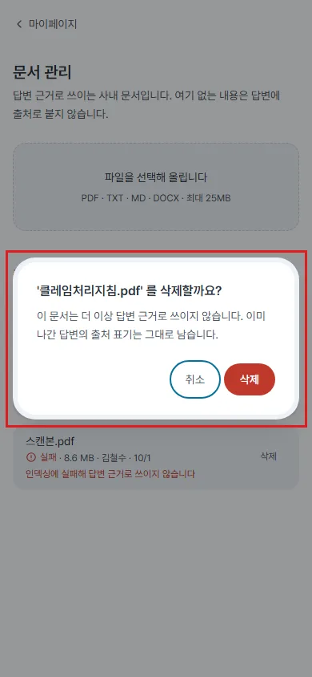 |
| desktop issued | 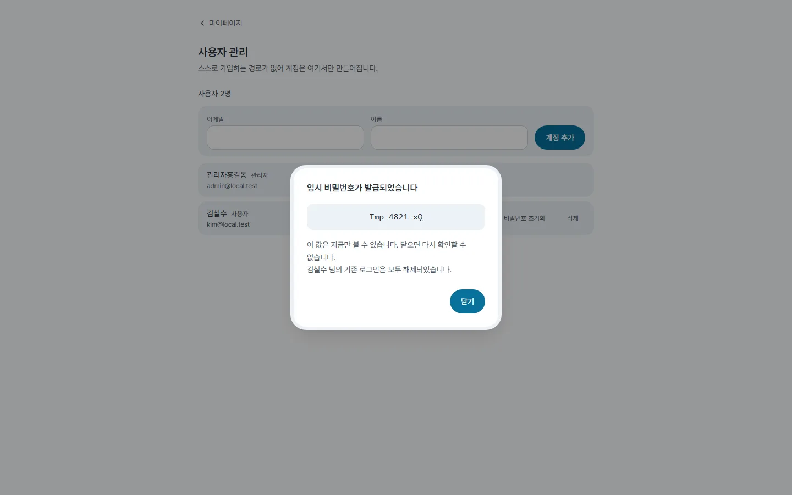 | 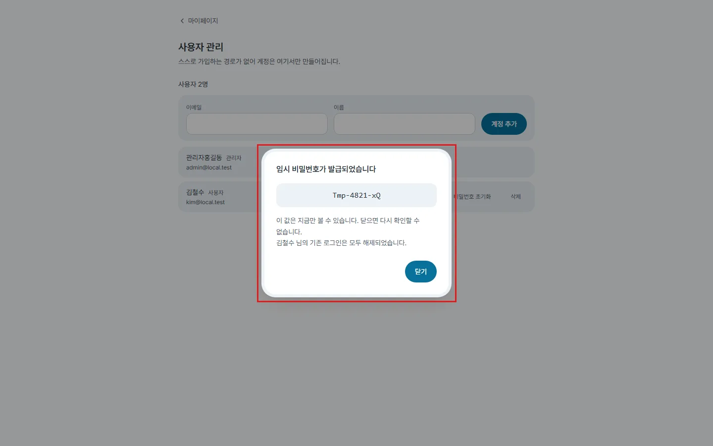 |
| mobile issued | 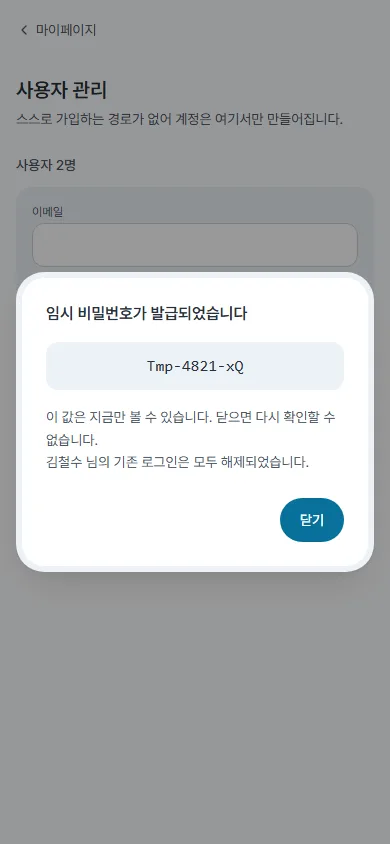 | 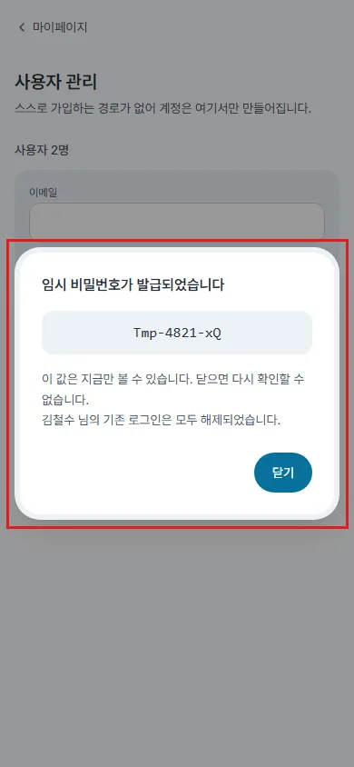 |
| desktop lightbox | 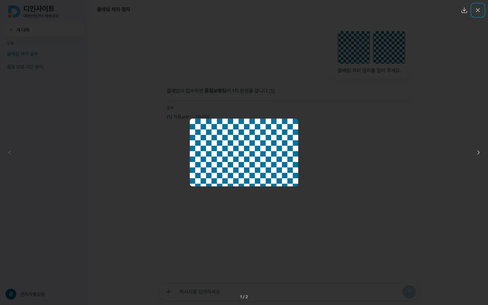 | 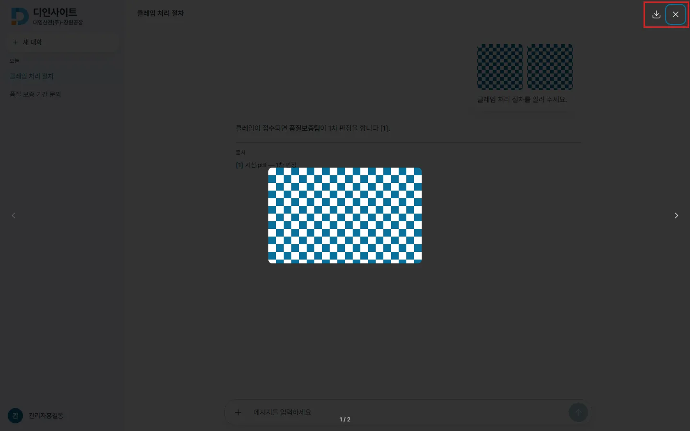 |
| mobile lightbox | 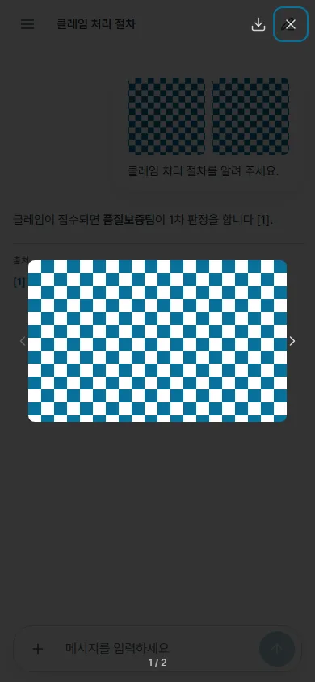 | 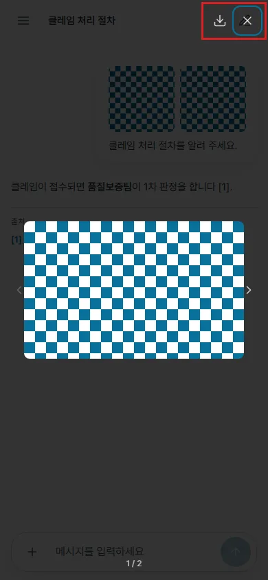 |
| desktop chat | 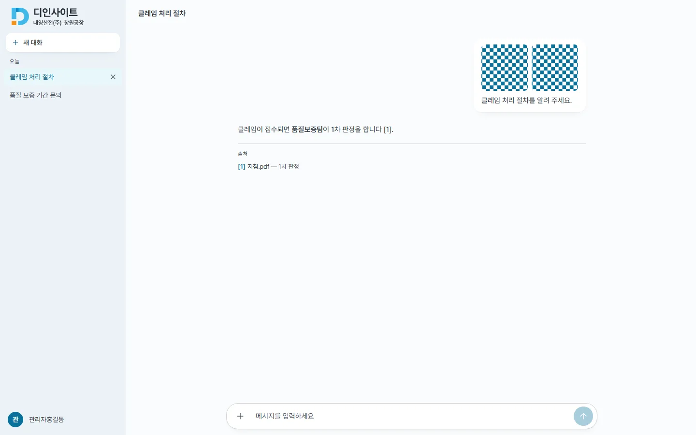 | 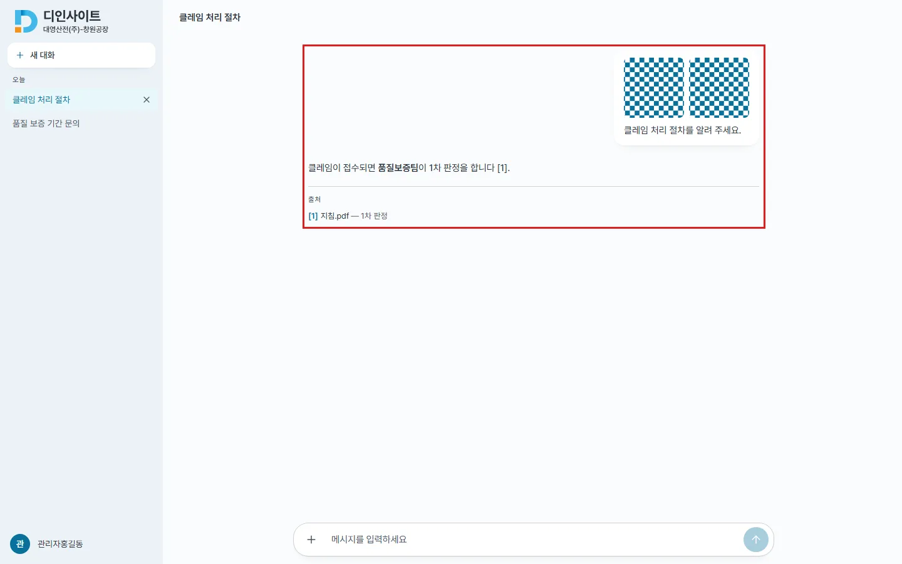 |
| mobile chat | 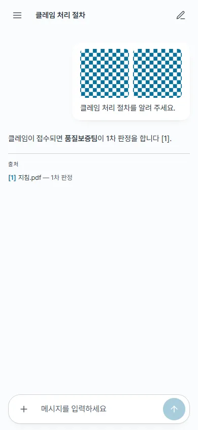 | 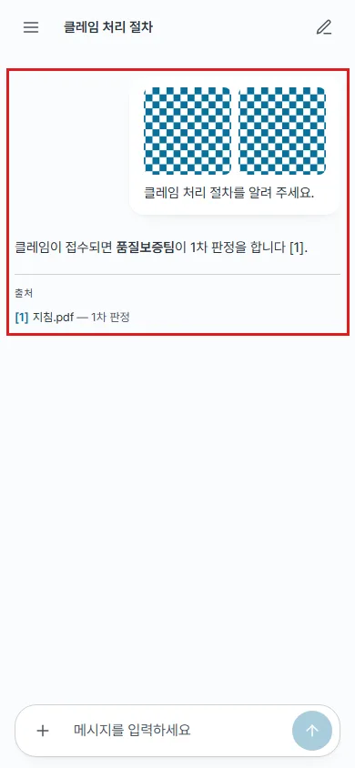 |
| mobile drawer | 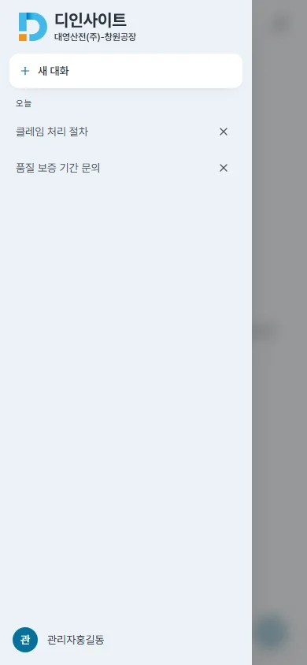 | 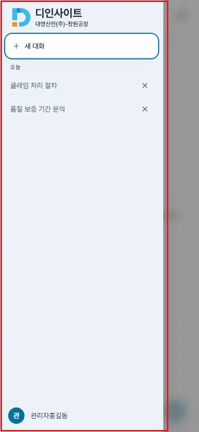 |

**테스트** : vitest 340 → 348(훅 3 · 드로어 1 · MessageList 2 · 문서 관리 1 · 사용자 관리 1). lint · build 통과. 문서 : `design-system.md` 접근성 규칙 · 드로어 · 움직임, `features.md` 모달 제약.
**지킨 결정** : 모달 틀 공통화 안 함(#105 §4 — 훅만 부름) · 배경 클릭 닫기 추가 안 함(#253) · 드로어 배경 탭 닫기 유지.
