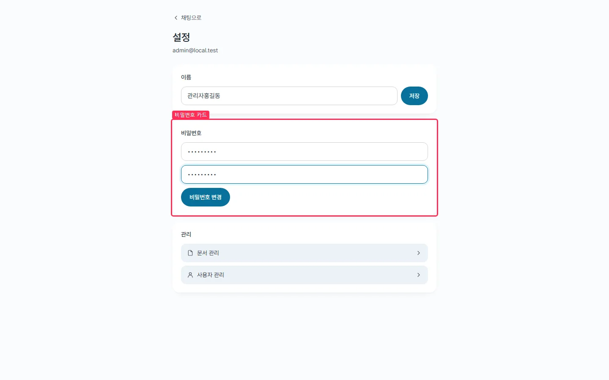
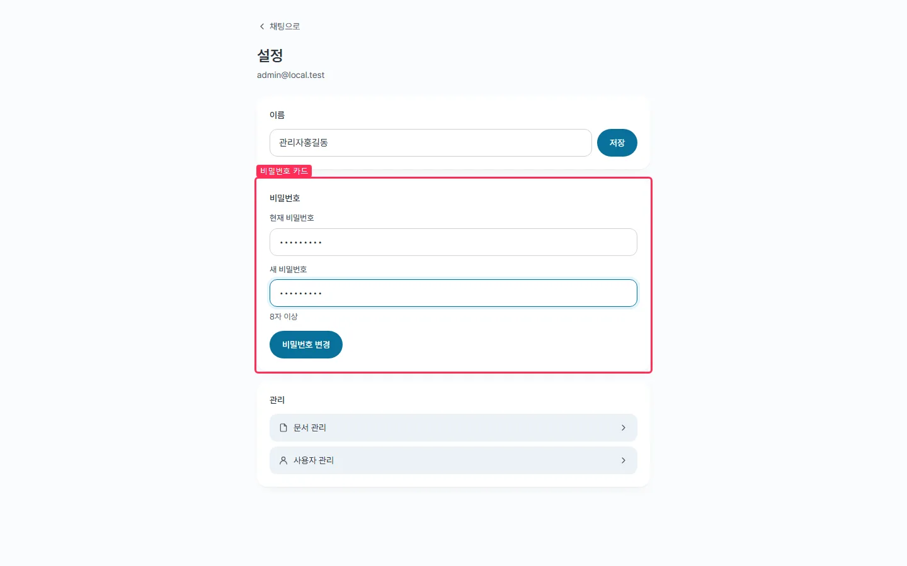
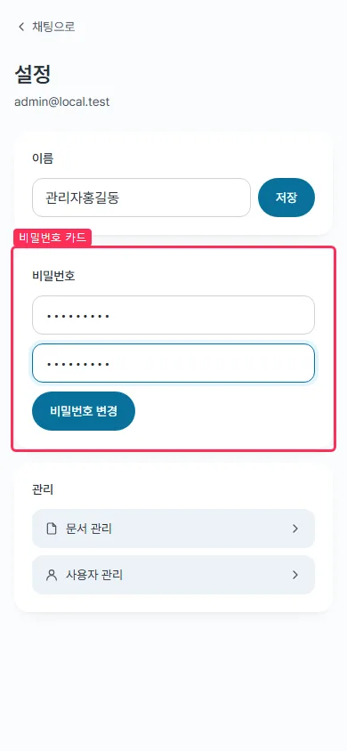
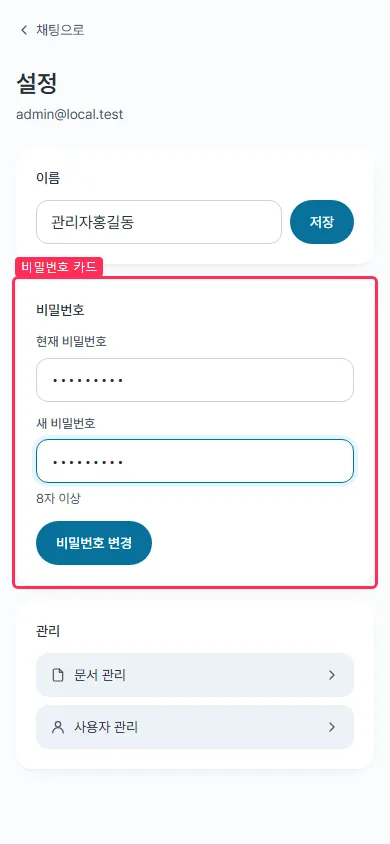

## #645 마이페이지 폼 — 보이는 라벨 · Enter 제출 · 저장 중 상태 — 전후 증거

브랜치 `fix/645-mypage-form` · 커밋 `8c2c012`

### 수정

- 비밀번호 칸 두 개에 **보이는 라벨**을 붙였다(LoginPage 의 `Field` 와 같은 모양). 「8자 이상」은 칸 밖 안내로 두고 `aria-describedby` 로 새 비밀번호 칸에 이었다. placeholder 는 지웠다 — 입력하는 순간 사라져 이름 구실을 못 한다
- 이름 · 비밀번호 카드를 각각 `<form>` 으로 감싸 **Enter 로 제출**된다. 버튼이 막힌 상태(규칙 미달 · 요청 중)에서는 Enter 로도 보내지 않는다
- 이름 저장도 비밀번호(#359)처럼 **요청 중 버튼을 막고** 「저장 중…」을 보인다

#105 와의 충돌은 없다 — #105 의 마이페이지 관련 행은 서버 `ProfileFlowTest` 판정 하나뿐이다.

### 측정 (playwright, 목업 API · 두 칸을 채운 상태 · 이어서 새 비밀번호 칸에서 Enter)

| 지표 | 전 (데스크톱 · 모바일) | 후 (데스크톱 · 모바일) |
|---|---|---|
| 「현재 비밀번호」 · 「새 비밀번호」 보이는 라벨 | 없음 · 없음 | 있음 · 있음 |
| 입력 중 「8자 이상」 안내가 보임 | 아니오 | 예 |
| form 요소 | 없음 | 있음 |
| Enter 로 보낸 변경 요청 | 0건 | `PATCH /api/profile/password` 1건 |
| 비밀번호 카드 높이 | 224px | 305px (+81) |
| 문서 높이 / 화면 높이 · 가로 넘침 | 900/900 · 844/844 · 없음 | 900/900 · 844/844 · 없음 |

카드가 81px 늘어도 두 폭 모두 한 화면 안에 들어간다. 원자료 : `before/measure.json` · `after/measure.json` · 캡처 스크립트 `cap645.mjs`

### 화면 (박스 = 비밀번호 카드, 두 칸을 채운 상태)

| | 전 | 후 |
|---|---|---|
| 데스크톱 |  |  |
| 모바일 |  |  |

### 확인

- `npm run lint` 통과 · `npm test` 340 → 344(새 테스트 4 : 보이는 라벨 · 설명, Enter 제출, 8자 미만 Enter 미제출, 이름 Enter 저장과 중복 방지) · `npm run build` 통과
- 기존 테스트의 `getByPlaceholderText` 2곳을 `getByLabelText` 로 바꿨다
