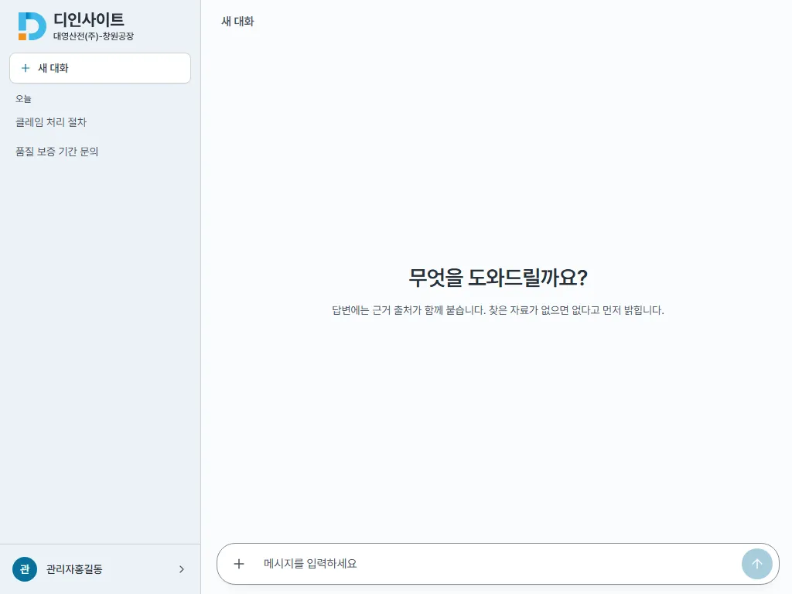
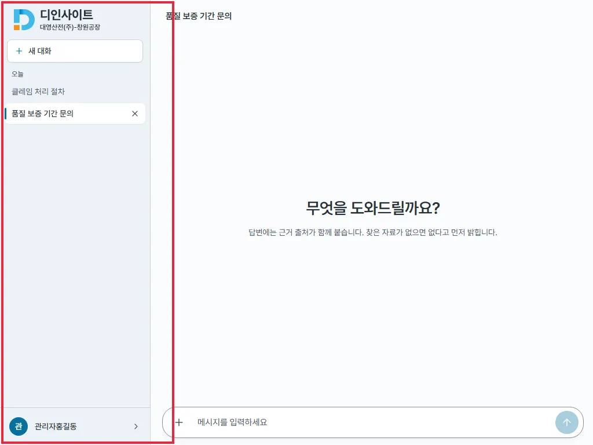
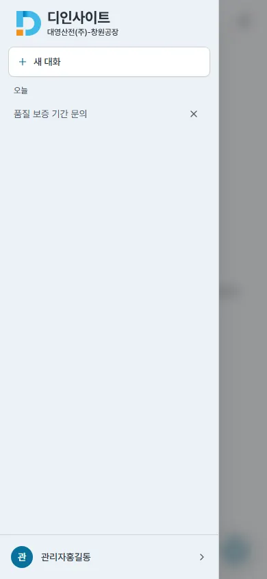
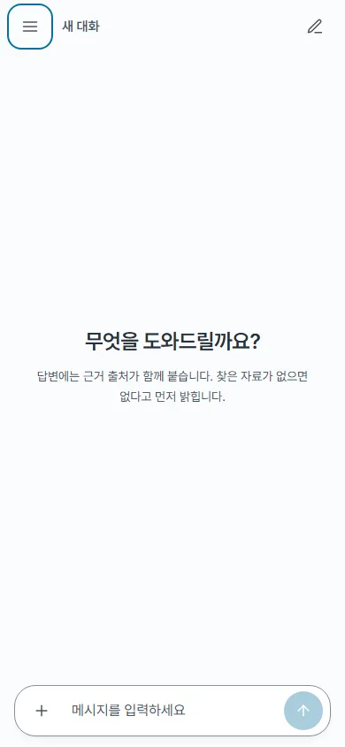

## #656 모달 · 드로어 포커스 후속 — 전후 증거

브랜치 `fix/656-modal-focus-followup` · 커밋 `07d527c` · `4ec0c16`

### 고친 것
- **[MAJOR] 드로어를 연 채 md 폭이 되면 앱 전체가 inert** — 드로어가 열린 동안 `matchMedia('(min-width: 768px)')` change 를 듣다가 넓어지면 닫는다(`ChatPage.tsx`). 닫히면 `useModalFocus` 정리가 inert 를, 기존 효과가 body 스크롤 잠금을 푼다
- **확인 창이 닫힌 뒤 포커스가 body 로 빠지던 흐름** — `ConfirmModal` 에 `returnTo` 를 더했다. 문서 · 사용자 삭제는 목록 머리(h2, `tabIndex=-1`)로, 비밀번호 초기화 실패는 요청이 끝나 다시 풀린 그 행의 초기화 버튼으로(성공이면 지금처럼 발급 창이 받음), 대화 삭제는 행이 실제로 빠지는 순간 「새 대화」로 옮긴다 — 확인 창이 닫힐 때는 아직 ✕ 가 있어 거기로 돌아갔다가 행이 빠지며 body 로 떨어졌다
- **StrictMode(개발) 첫 포커스** — `useModalFocus` 가 처음 옮길 때 `data-autofocus` 요소를 먼저 고른다(확인 창 「취소」 · 확대 보기 「닫기」 · 발급 창 「닫기」)
- 모달 틀 공통화 안 함(#105) · 비밀번호 창 배경 클릭 없음(#253)은 그대로

### 브라우저 탐침 (목업 API, `p656.mjs`)

| 항목 | 전 | 후 |
|---|---|---|
| 390 에서 드로어 열고 1024 로 — inert 요소 수 | 2 | **0** |
| 〃 body overflow | hidden | **(비어 있음)** |
| 〃 데스크톱 사이드바 「새 대화」가 inert 안 | true | **false** |
| 〃 사이드바 대화를 눌러 열림 | **안 열림** | 열림 |
| 비밀번호 초기화 실패 뒤 포커스(두 폭) | BODY | **김철수 비밀번호 초기화 버튼** |
| 문서 삭제 뒤 포커스(두 폭) | BODY | **h2「문서 1건」** |
| (모바일) 드로어 안 대화 삭제 뒤 포커스 | BODY | **새 대화** |
| 〃 그 뒤 Esc → 드로어 | 열린 채(1) — Esc 가 안 닿음 | **닫힘(0)** |

원자료 : `before/probe.json` · `after/probe.json`

### 화면

1024 로 넓힌 뒤 사이드바의 「품질 보증 기간 문의」를 누른 결과다. 전 화면은 겉으로는 멀쩡해 보이지만 사이드바 전체가 inert 라 눌리지 않아 제목이 「새 대화」 그대로다(박스는 후의 사이드바).

| 전 | 후 |
|---|---|
|  |  |

| | 전 | 후 |
|---|---|---|
| 모바일 드로어 안 삭제 뒤 Esc |  |  |

### 확인
- `npm run lint` · `tsc` 통과 · `npx vitest run` 359 → **366**(+7 : 회전 닫기 · 드로어 안 확인 창 Esc · StrictMode 첫 포커스 · 문서 삭제 · 사용자 삭제 · 초기화 실패 · 대화 삭제 포커스) · `npm run build` 통과
