## #657 화면 후속 — 전후 증거

브랜치 `fix/657-screen-followup` · 커밋 `e82cf32`

### 수정
1. 관리 문서 · 사용자 화면 : 첫 로드가 실패하면(`loaded` 아님) 목록 카드를 그리지 않는다 — 빈 `ul` 에 #646 의 테두리 · 그림자가 붙어 배너 아래 2px 빈 상자로 남았다
2. 스켈레톤 상태 전이 테스트 : 관리 두 화면에서 「첫 로드 중 스켈레톤 → 실패하면 스켈레톤 · 빈 목록을 걷고 오류만」(ChatPage 이력 스켈레톤은 기존 #291 테스트 둘이 지킨다)
3. 표(`TableScroll`) : 실제로 넘칠 때만 `tabIndex=0` · `role="region"` · 이름 「표」 — 넘치지 않는 표마다 랜드마크 · Tab 정지점이 생기던 것
4. 답변 준비 줄 : 단계 글자가 없으면 점 셋만(「…」 글자를 겹쳐 그리던 것). 낭독용 status 는 「…」 그대로
5. 첨부 제거 누르는 영역 : 모바일 인셋 8 → 5px(36 → 30px). 원이 카드 밖 6px 이라 영역이 카드 끝에서 14px 나가 간격 12px 을 넘어 이웃 「확대」와 겹쳤다 → 11px

### 측정(목업 API · 같은 빌드 조건, `cap657.mjs`)

| 항목 | 데스크톱 1440 전 → 후 | 모바일 390 전 → 후 |
|---|---|---|
| 첫 로드 실패 때 빈 목록 상자(문서 · 사용자) | 높이 2px 상자 1 · 1 → 없음 | 높이 2px 상자 1 · 1 → 없음 |
| 표 상자(넘침 여부) | 720/720 넘침 없음 : region · tabIndex 있음 → **없음** | 536/358 넘침 : region · tabIndex 있음 → 있음(그대로) |
| 첨부 제거 누르는 영역 · 이웃 「확대」와 겹친 면적 | 28×28 · 0 → 28×28 · 0 | 36×36 · **44px²** → 30×30 · **0** |
| 준비 줄 「…」 겹침 | 목업에서 재현 불가(#646 과 같은 한계) — 단위 테스트로 지킴 | 같음 |

원자료 : `before/measure.json` · `after/measure.json`

### 화면(after 의 빨간 외곽선 = 바뀐 자리)

| | 전 | 후 |
|---|---|---|
| 데스크톱 · 문서 실패 | 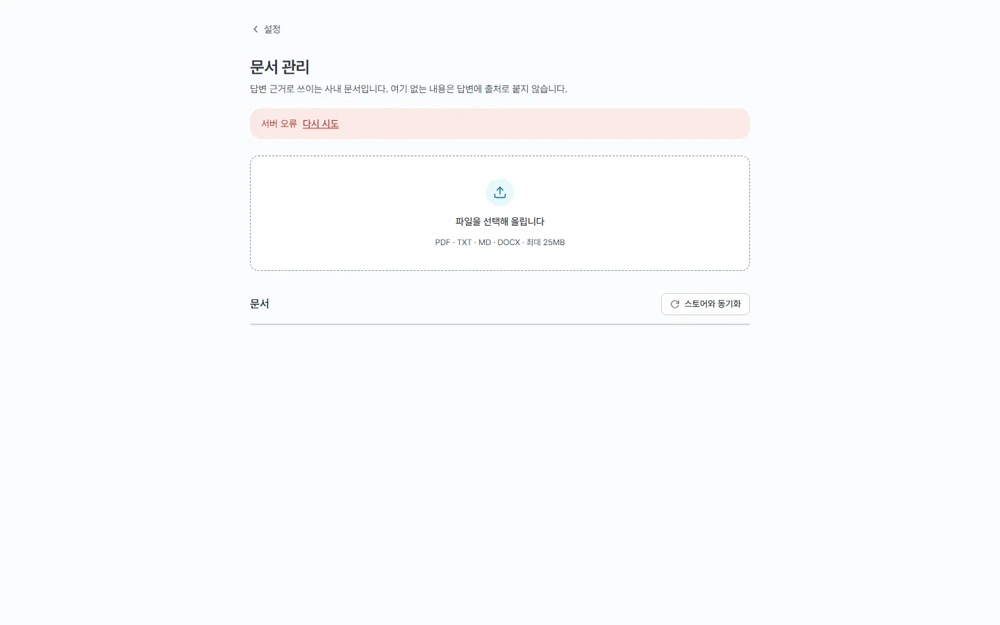 | 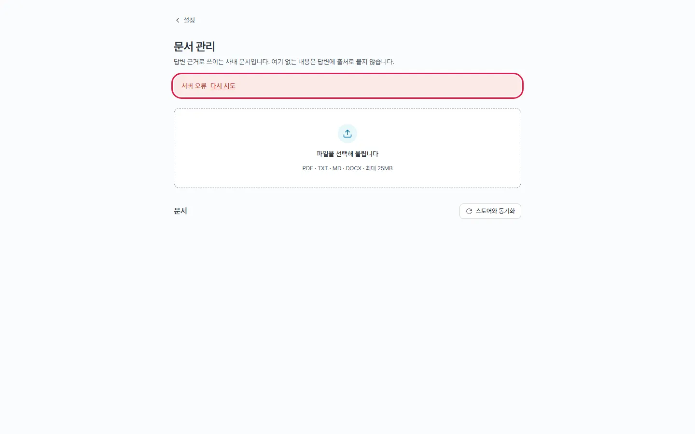 |
| 모바일 · 문서 실패 | 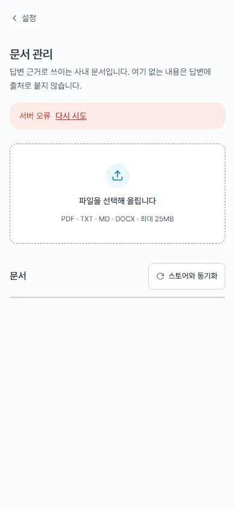 | 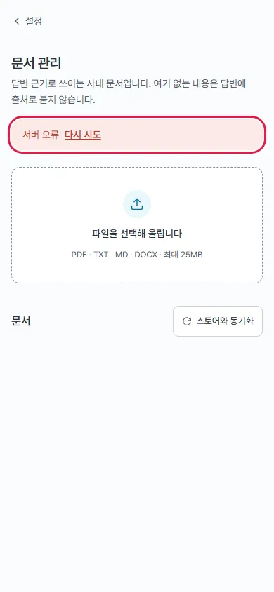 |
| 데스크톱 · 사용자 실패 | 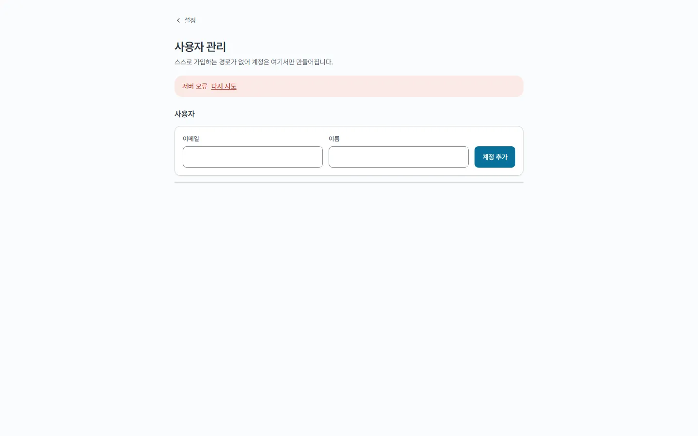 | 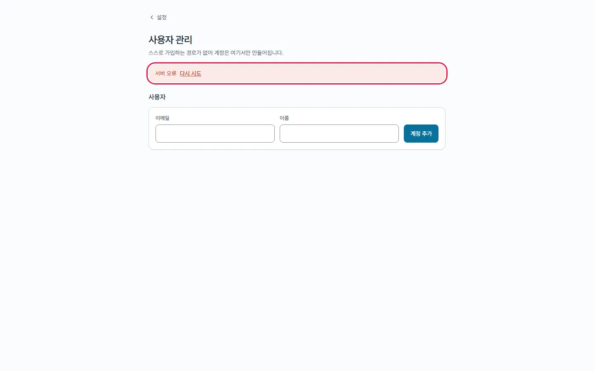 |
| 모바일 · 사용자 실패 | 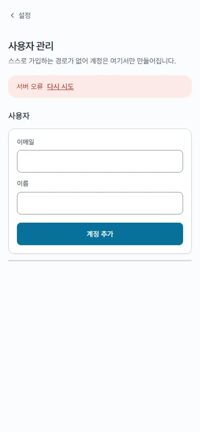 | 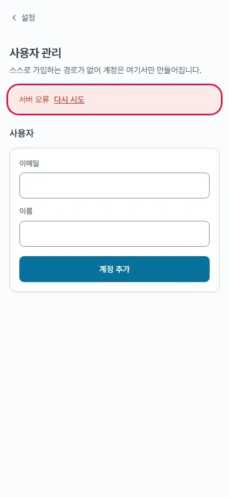 |
| 데스크톱 · 표 | 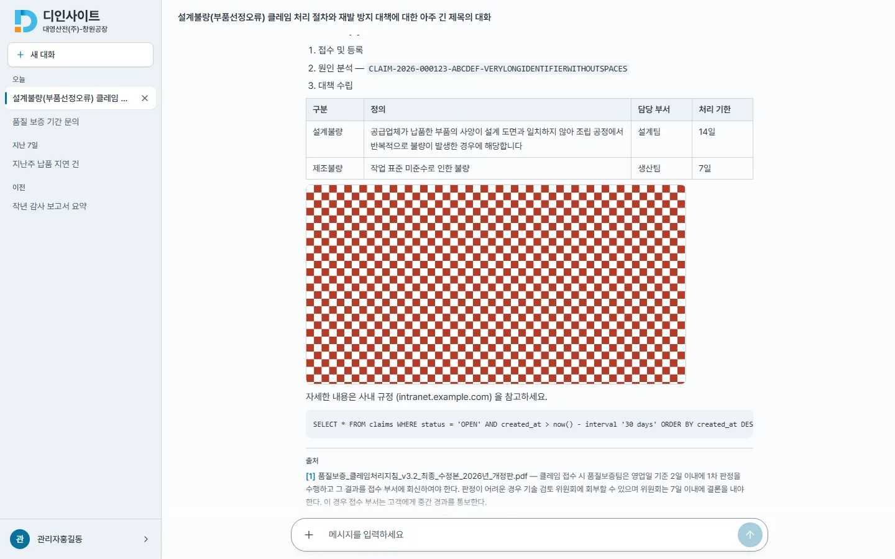 | 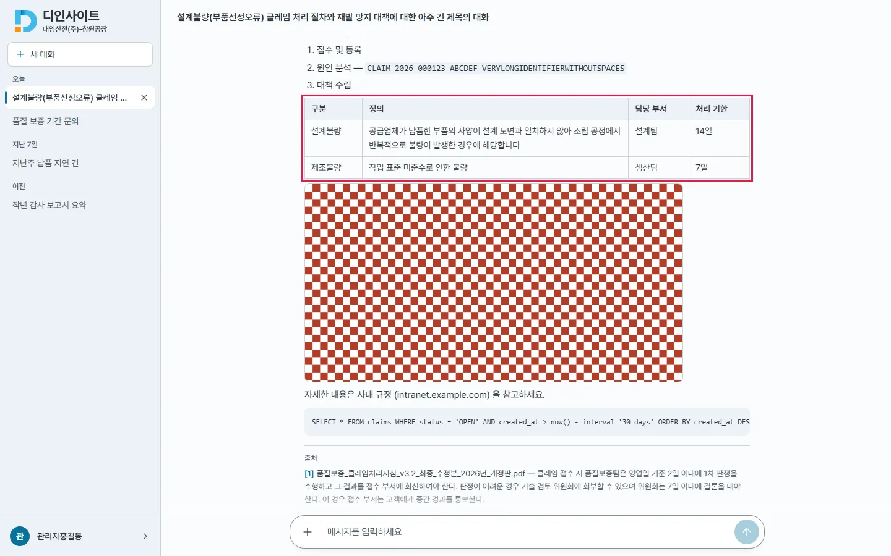 |
| 모바일 · 표 | 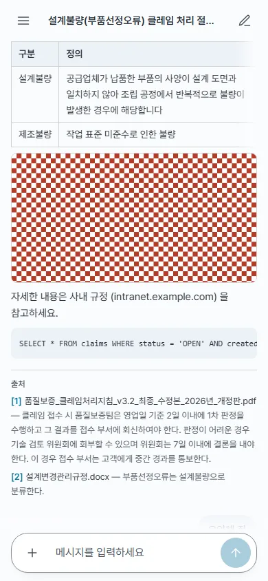 | 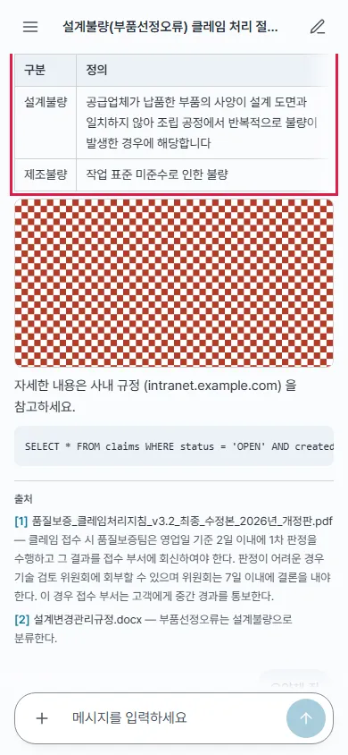 |
| 데스크톱 · 첨부 | 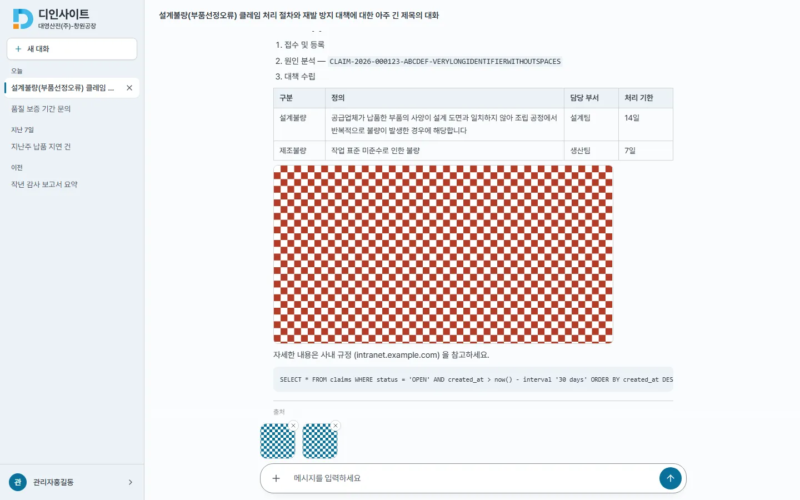 | 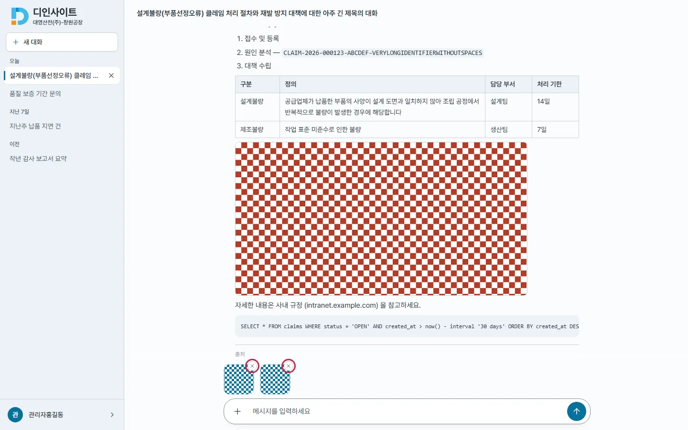 |
| 모바일 · 첨부 |  | 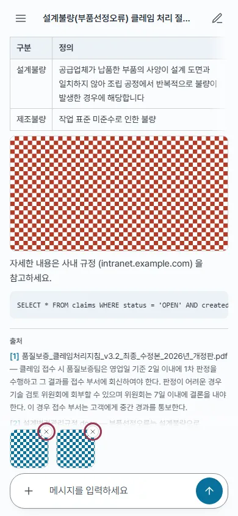 |

표 · 첨부의 겉모양은 같다(바뀐 것은 속성 · 누르는 영역). 실패 화면은 배너 아래 빈 상자가 사라졌다.

### 확인
- `npm run lint` 통과 · `npm test` 359 → 363(+4 : Markdown 1 · MessageList 1 · 관리 문서 1 · 관리 사용자 1, 기존 Markdown region 테스트는 넘치는 경우로 바꿈) · `npm run build` 통과
