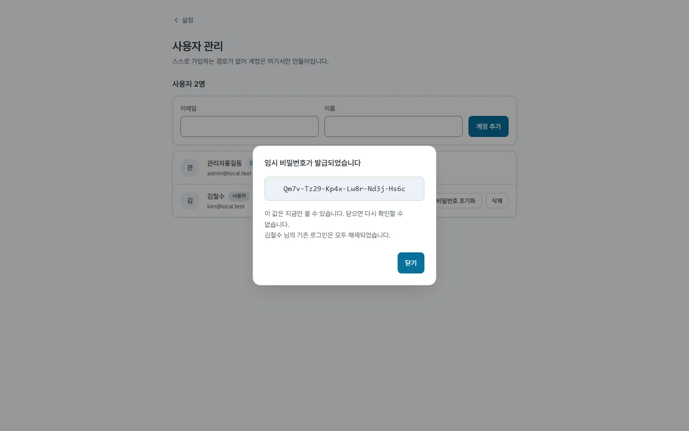
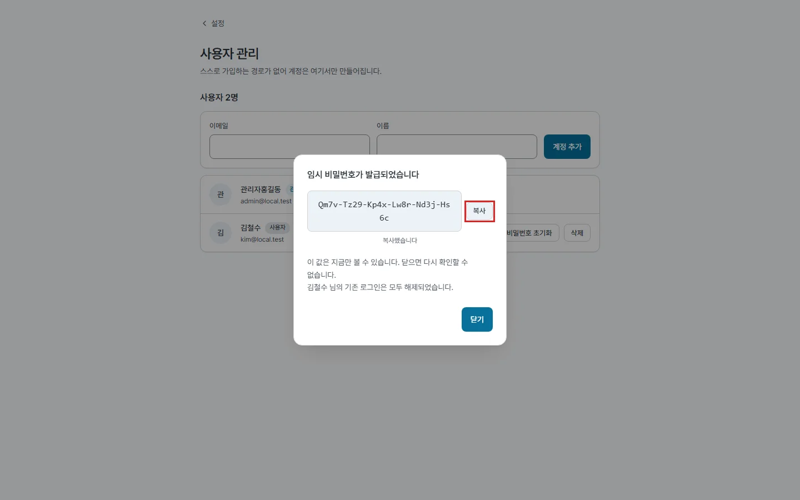
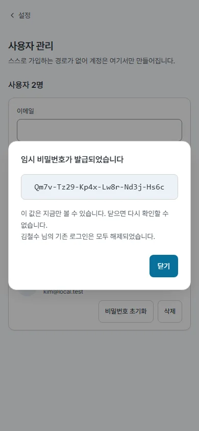
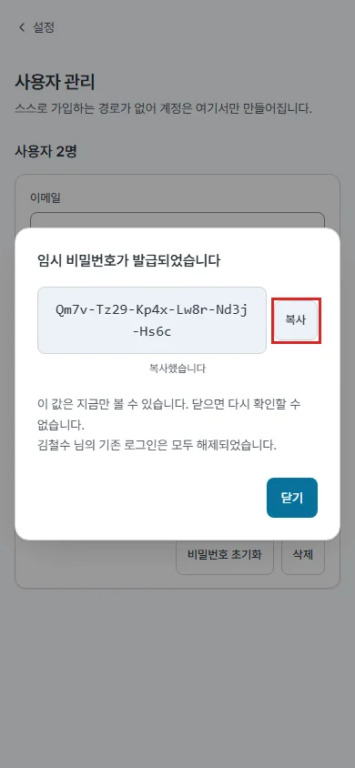
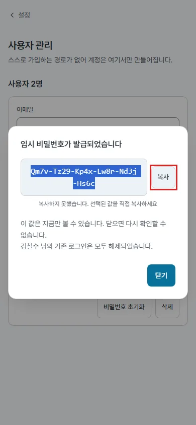

## #662 임시 비밀번호 창 복사 버튼 — 전후

임시 비밀번호 창(`AdminUsersPage.tsx` `IssuedDialog`)의 값 옆에 보조 버튼 「복사」를 두었다. 클릭 핸들러 안에서 `navigator.clipboard.writeText` 를 부르고 결과를 `role="status"` 문구로 알린다. 클립보드가 막히면(권한 · 비보안 컨텍스트 · 구형 브라우저) 값을 선택해 두고 「선택된 값을 직접 복사하세요」라고 알린다. 포커스 처리(첫 포커스 「닫기」 · 닫으면 연 버튼으로, #644 · #656)와 배경 클릭으로 안 닫힘(#253)은 그대로.

### 측정 (`cap662.mjs`, 목업 API · https 출처 · 실제보다 긴 29자 값)

| 폭 | 지표 | 전 | 후 |
|---|---|---|---|
| 데스크톱 1440 | 복사 버튼 | 없음 | 48×32 · 클립보드 = 값 · 「복사했습니다」 |
| 모바일 390 | 복사 버튼 | 없음 | **48×44** · 클립보드 = 값 · 「복사했습니다」 |
| 모바일 · 클립보드 거절 | — | 없음 | 값 전체 선택 · 「복사하지 못했습니다. 선택된 값을 직접 복사하세요」 |
| 두 폭 | 창 안 가로 넘침 · 페이지 가로 스크롤 | 0 · 없음 | 0 · 없음 |
| 두 폭 | 창이 뜬 뒤 포커스 | 닫기 | 닫기 |

원자료 : `before/measure.json` · `after/measure.json`

### 화면 (박스 = 복사 버튼)

| | 전 | 후 |
|---|---|---|
| 데스크톱 |  |  |
| 모바일 |  |  |
| 모바일 · 클립보드 거절 |  |  |

### 확인

- 테스트 +2(복사 성공 · 거절 시 선택 + 안내) — vitest 370 → 372 · lint · build · docs 게이트 통과
- 문서 : `features.md` FEAT-ADMIN-003 성공 응답 · `design-system.md` §5 보조 버튼 쓰임에 한 줄씩
