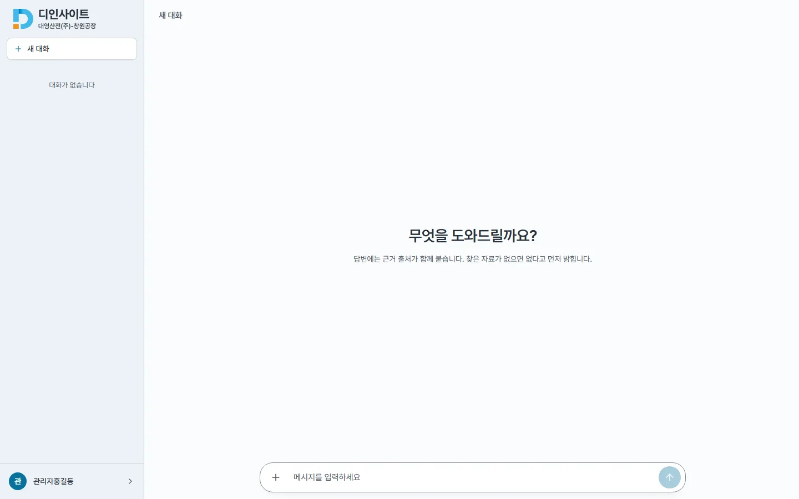
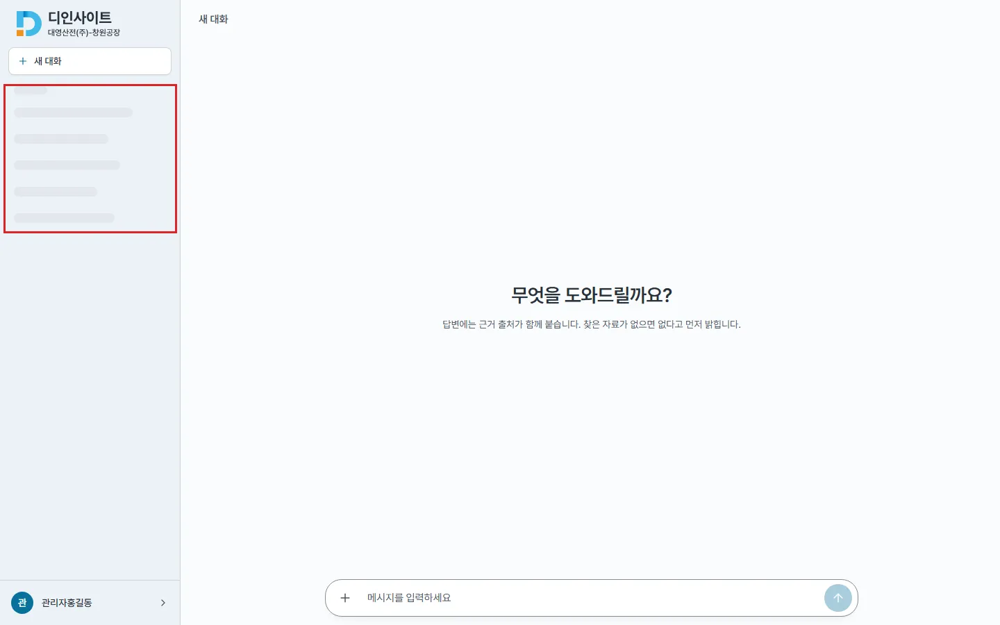
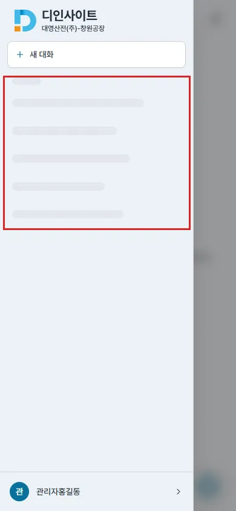

## #663 사이드바 첫 로드 — 전후 증거

### 원인

`useChat` 에 대화 목록 로딩 상태가 없어, 사이드바가 「아직 안 옴」과 「비었음」을 가르지 못했다. 첫 목록이 오기 전에도 `conversations.length === 0` 이라 「대화가 없습니다」를 먼저 보였다(실패는 #385 로 이미 오류 배너가 따로 알림).

### 수정

- `useChat` : `conversationsLoading`(첫 목록 응답이 끝나면 — 성공 · 빈 목록 · 실패 모두 — 내림). 첫 로드 요청에 세대를 따로 잡아 StrictMode(개발)가 두 번 낸 요청 중 마지막 것이 끝날 때만 내린다
- `Sidebar` : 로딩 중이고 목록이 비었을 때만 대화 행 모양 스켈레톤(`AdminListSkeleton` 과 같은 결 · `bg-highlight` · `motion-reduce:animate-none`, 낭독기에는 숨김). 낭독용 상태 문구는 늘 있는 `role="status"` 그릇에 글만 넣는다(#484 · #590). 그 사이 만든 새 대화가 있으면 스켈레톤 없이 목록을 보인다. 「대화가 없습니다」는 다 읽고 비었을 때만
- 상태 줄(sr-only)이 스크롤 상자 밖으로 나가지 않게 `nav` 에 `relative`(#642 와 같은 이유) — 측정 문서 세로 넘침 0
- `design-system.md` 로딩 절 · 토큰 표 동기화(#646 이 「범위 밖」이라 적은 문장 교체)

### 측정 (목업 API, 대화 목록 응답 3초 지연, 모바일은 드로어를 열어서 · `probe.json`)

| 폭 | 상태 | 전 | 후 |
|---|---|---|---|
| 데스크톱 1440 | 로딩 중 | 「대화가 없습니다」 보임 · 상태 문구 없음 | 스켈레톤 · 「대화 목록 불러오는 중」 · 빈 문구 없음 |
| | 목록 도착 | 목록 2개 제목 | 같음 |
| | 빈 목록 도착 | 「대화가 없습니다」 | 같음 |
| | 실패 | 「대화가 없습니다」 + 오류 배너 | 같음(스켈레톤 걷힘) |
| 모바일 390 | 로딩 중 | 「대화가 없습니다」 보임 | 스켈레톤 · 상태 문구(보이는 그릇 1개, 숨은 데스크톱 사이드바 쪽은 display:none) |
| | 목록 · 빈 · 실패 | 데스크톱과 같음 | 같음 |

### 화면

박스는 스켈레톤 자리다.

| | 전(로딩 중) | 후(로딩 중) |
|---|---|---|
| 데스크톱 |  |  |
| 모바일 |  |  |

다 읽은 뒤(목록 · 빈 · 실패)는 `before/` · `after/` 의 `*-done.webp`.

### 확인

- `npm run lint` · `tsc` · `npm run build` 통과 · vitest 370 → 376(상태 전이 3 : 목록 · 빈/실패 · StrictMode, 사이드바 3 : 로딩 · 빈 · 로딩 중 새 대화)
- 캡처 스크립트 `cap663.mjs`(토큰은 실행 때 생성)
