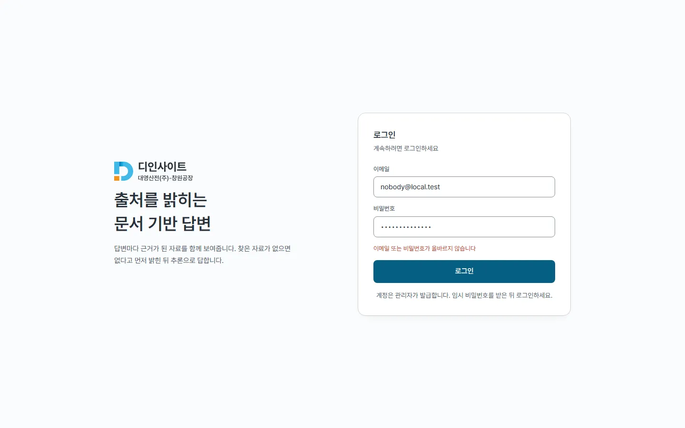
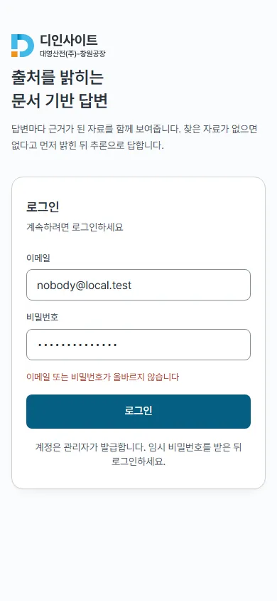
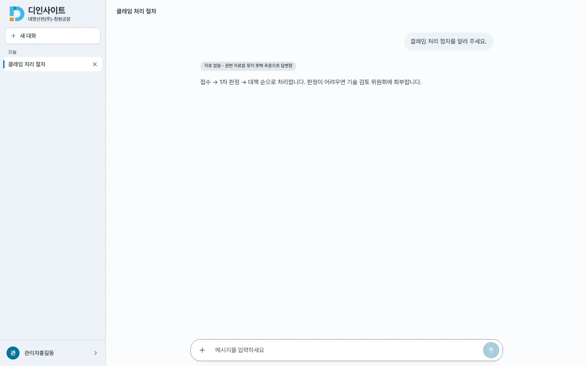
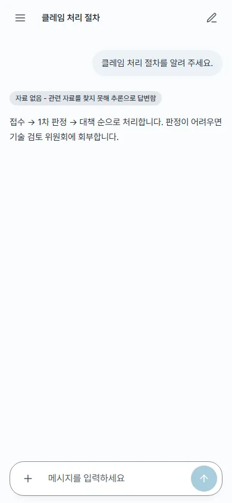

## #664 접근성 · 정렬 잔여 — 전후

### 1. 사이드바 폭 조절 손잡이(데스크톱 전용)
`ResizableSidebar.tsx` : 자리(4px)는 그대로 두고 누르는 영역만 `::after` 로 **본문 쪽** 8px 넓혔다(사이드바 쪽으로 넓히면 대화 목록 스크롤바를 덮는다). 뒤에 오는 본문 칼럼이 그 영역을 덮어 처음엔 넓어지지 않아 `z-10` 을 줬다. 키보드 포커스 선 1 → 2px(hover 선은 1px 그대로).

| 측정(1440, `elementFromPoint` 1px 단위) | 전 | 후 |
|---|---|---|
| 누르는 폭 | 4px | **12px** |
| 사이드바 위로 나온 폭 | 0 | 0 |
| 본문 위로 나온 폭 | 0 | 8px — 헤더 제목 버튼(x=276) 바로 앞 x=275 에서 끝나 가로채는 요소 없음 |
| 키보드 포커스 선 | 1px | **2px** |

| 전 | 후 |
|---|---|
|  |  |

### 2. 로그인 오류를 입력칸에 연결(두 폭 공통)
`LoginPage.tsx` : 오류가 있으면 두 입력칸에 `aria-invalid="true"` · `aria-describedby`(오류 문구 id, `useId`). 겉모양 변화 없음. 테스트 1 추가(370 → 371).

| 측정 | 전 | 후 |
|---|---|---|
| 데스크톱 · 모바일 이메일 · 비밀번호 칸 | `aria-invalid` 없음 · 설명 없음 | `true` · 「이메일 또는 비밀번호가 올바르지 않습니다」 |

| | 전 | 후 |
|---|---|---|
| 데스크톱 |  |  |
| 모바일 |  |  |

### 3. 데스크톱 헤더 제목 정렬 — 고치지 않음(근거)
다시 쟀다 : 데스크톱 제목 글자 x=286(헤더 왼쪽 264 + 여백) · 본문 칼럼 x=492 / 모바일 제목 x=70(햄버거 다음) · 본문 x=16. 어긋남은 그대로지만 **의도된 배치**로 판단해 바꾸지 않았다 — 설계 문서가 따르는 ChatGPT · Claude 형은 제목(모델 · 대화 이름)을 본문 영역의 **왼쪽 위**에 두고 본문만 가운데 칼럼(max-w-3xl)으로 모은다. 제목을 가운데 칼럼에 맞추면 사이드바 폭을 바꿀 때마다 제목이 움직이고, 넓은 화면에서 헤더 왼쪽이 비어 메뉴 · 제목 · 새 채팅 버튼의 한 줄 구성이 흐트러진다. 측정값은 `before/` · `after/probe.json` 에 그대로 있다(전후 같음).

| | 전 = 후 |
|---|---|
| 데스크톱 |  |
| 모바일 |  |

### 4. 사용자 확인 필요 — 낭독기 실기기
답변 스트리밍이 끝나 메시지 목록의 `aria-busy` 가 풀린 뒤 낭독기가 완성된 답을 다시 읽는지는 자동화로 확인할 수 없다(#644 · 리뷰 LOW).
- 방법 : Windows **NVDA**(또는 내레이터) · macOS/iOS **VoiceOver** 를 켜고 운영 화면에서 질문 하나를 보낸다 → 답이 끝날 때까지 기다린다 → 답이 한 번만 읽히는지, 토큰 조각마다 끊겨 읽히거나 끝난 뒤 두 번 읽히지 않는지 듣는다
- 결과에 따라 후속 판단(`aria-relevant` 조정 등) — 이 이슈에서는 코드 변경 없음

### 확인
- `npm run lint` 0 · `tsc` 0 · `npm run build` 통과 · vitest 370 → 371(동시 부하에서 1회 간헐 실패 뒤 연속 2회 371/371)
- 측정 스크립트 `p664.mjs`(목업 API, 토큰은 실행 때 생성)
