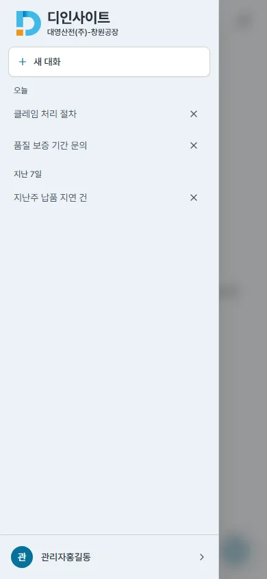
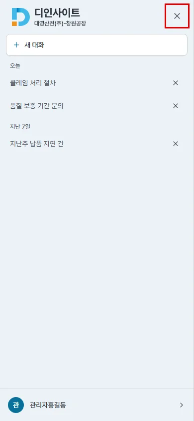
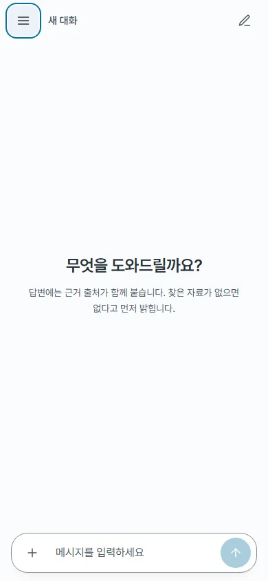
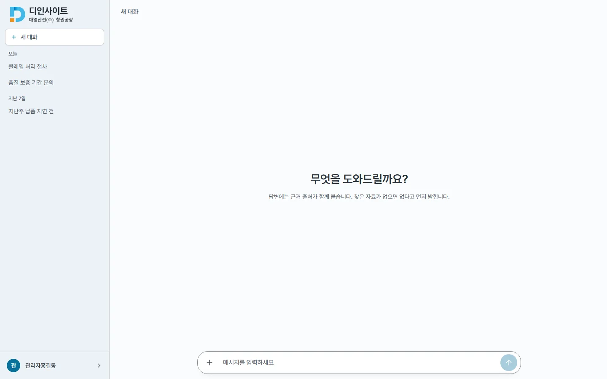

## #669 모바일 사이드바 전체 화면 + X 닫기 — 전후 증거

브랜치 `fix/669-fullscreen-mobile-drawer` · 커밋 `f02f779e`

### 수정

- 모바일(&lt;768px) 드로어(`ChatPage.tsx` `MobileDrawer`)를 화면 전체(`fixed inset-0`, 바탕 `surface`)로 바꿨다. 뒤를 가리던 반투명 막(스크림)과 그림자는 없앴다
- 오른쪽 위에 X 버튼(44px, 이름 「대화 목록 닫기」) — 사이드바 머리 줄(로고, 왼쪽)의 오른쪽 빈자리. 사이드바는 데스크톱과 같은 컴포넌트라 X 는 드로어에만 둔다
- #644 · #656 동작은 그대로 : 대화창 의미 · 열린 동안 바깥 `inert` · 스크롤 잠금 · Esc 닫기 · 회전 시 닫기 · 드로어 안 확인 창 Esc 분기 · 닫으면 햄버거로 포커스 복귀
- 덮인 배경이 없어 배경 탭으로 닫기는 없어졌다(X · Esc 로 닫는다). 배경 탭을 지키던 테스트는 원래 없었고, X 로 닫는 테스트를 더했다
- `design-system.md` §7-1 · 그림자 · 스크림 행, `frontend.md` 드로어 줄 동기화

### 측정 (playwright, 목업 API, `cap669.mjs`)

| 항목 | 전 | 후 |
|---|---|---|
| 모바일 390 드로어 폭 / 화면 폭 | 320 / 390 | **390 / 390** |
| X 닫기 버튼 | 없음 | 44 × 44 (x 334 · y 10) |
| 연 뒤 포커스 | 「새 대화」 | 「새 대화」(같음) |
| 열린 동안 inert · body 스크롤 | 2 · hidden | 2 · hidden(같음) |
| 닫는 방법 → 닫힌 뒤 포커스 · inert · 스크롤 | 배경 탭 → 햄버거 · 0 · 풀림 | **X** → 햄버거 · 0 · 풀림 |
| Esc 로 닫기 | 햄버거 · 0 · 풀림 | 햄버거 · 0 · 풀림(같음) |
| 데스크톱 1440 사이드바 | 폭 260 | 폭 260 · **픽셀 대조 차이 없음** · X 0개 |

원자료 : `before/probe.json` · `after/probe.json`

### 화면

| | 전 | 후 |
|---|---|---|
| 모바일 드로어 |  |  |
| 모바일 닫은 뒤 |  |  |
| 데스크톱 사이드바(변화 없음) |  |  |

박스는 새 X 버튼이다.

### 확인

- `npm run lint` · `tsc` · `npm run build` 통과 · `npx vitest run` 379 → **380**(+1 : X 로 닫기 · 포커스 복귀 · inert 해제 · 스크림 없음)
- `bash scripts/check-all.sh docs` 통과
