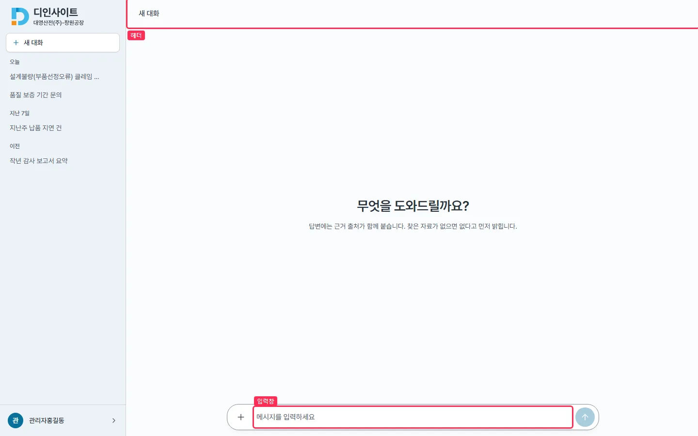
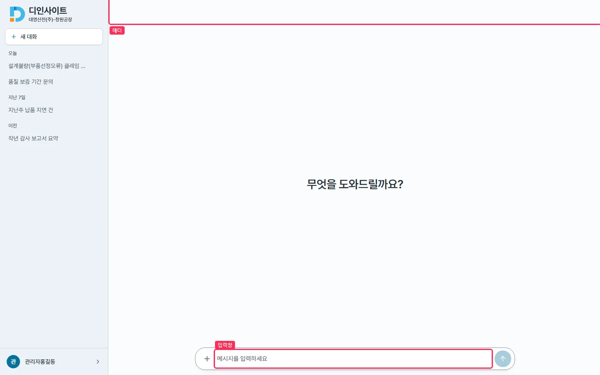
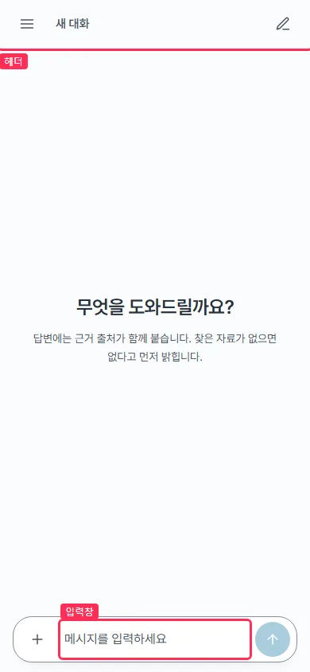
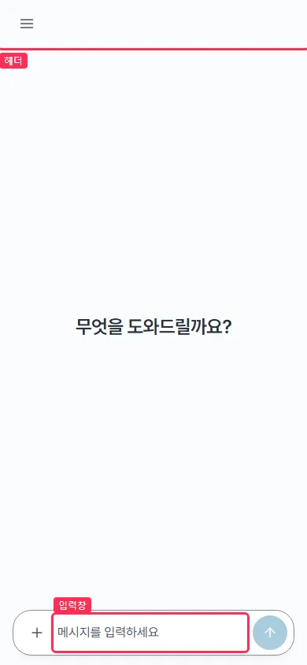
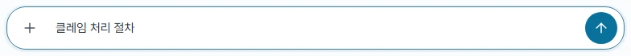
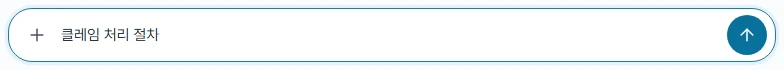
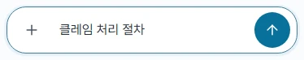
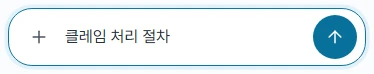
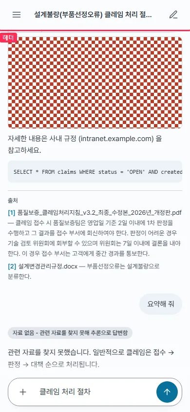
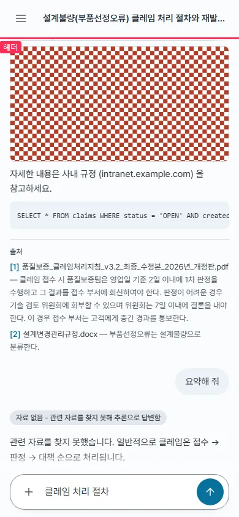

## #670 채팅 화면 다듬기 — 전후

### 바꾼 것
1. **「+」와 입력 글자 간격** — 입력줄 `gap-2`(8px) + 입력칸 안쪽 4px 로 버튼 끝 ~ 글자가 12px 였다. 첨부 버튼에만 `-mr-2` 를 줘 그 뒤 간격만 지운다(보내기 쪽 간격 · 버튼 44/40 · 한 줄 높이 · iOS 16px 그대로)
2. **새 대화 헤더 제목 제거** — 대화가 없을 때 헤더의 「새 대화」 글자를 그리지 않는다. 대화가 있으면 제목(이름 바꾸기)은 그대로
3. **빈 화면 보조 문구 제거** — 「무엇을 도와드릴까요?」 한 줄만
4. **헤더 오른쪽 새 채팅 아이콘 제거**(모바일 전용이던 버튼) — 새 대화는 사이드바(드로어)의 「새 대화」로. 확인 창(#503)은 사이드바 경로로 그대로(기존 테스트). 쓰이지 않게 된 `IconEdit` 도 지웠다

### 측정 (`c670.mjs`, 목업 API · 같은 빌드 조건)

| 지표 | 데스크톱 1440 전 → 후 | 모바일 390 전 → 후 |
|---|---|---|
| 「+」 버튼 끝 → 글자 시작 | 12 → **4px** | 12 → **4px** |
| 「+」 모양 끝 → 글자 시작 | 22 → 14px | 24 → 16px |
| 「+」 버튼 · 한 줄 높이 · 글자 크기 | 40×40 · 40 · 15px (그대로) | 44×44 · 44 · 16px (그대로) |
| 새 대화 헤더 버튼 / 글자 | 없음 / 「새 대화」 → 없음 / 없음 | 목록 열기 · 새 채팅 / 「새 대화」 → 목록 열기 / 없음 |
| 대화를 연 헤더 | 제목 그대로 | 목록 열기 · 제목 (새 채팅 빠짐) |
| 빈 화면 글 | 인사 + 보조 문구 → 인사만 | 같음 |
| 가로 넘침 | 0 | 0 |

### 화면

| | 전 | 후 |
|---|---|---|
| 데스크톱 빈 화면 |  |  |
| 모바일 빈 화면 |  |  |
| 데스크톱 입력줄 |  |  |
| 모바일 입력줄 |  |  |
| 모바일 대화 |  |  |

박스는 헤더 · 입력창. 원자료 `before/measure.json` · `after/measure.json`

### 확인
- `npm run lint` 통과 · `npx vitest run` 379 → 380(새 채팅 헤더 버튼 테스트 1 → 헤더 · 제목 테스트 2, 빈 화면 보조 문구 없음 단언 추가) · `npm run build` 통과 · `check-all.sh docs` 통과
- 문서 : `design-system.md`(입력줄 간격 · 빈 채팅 인사 · 모바일 헤더) · `frontend.md`(모바일 헤더 구성)
