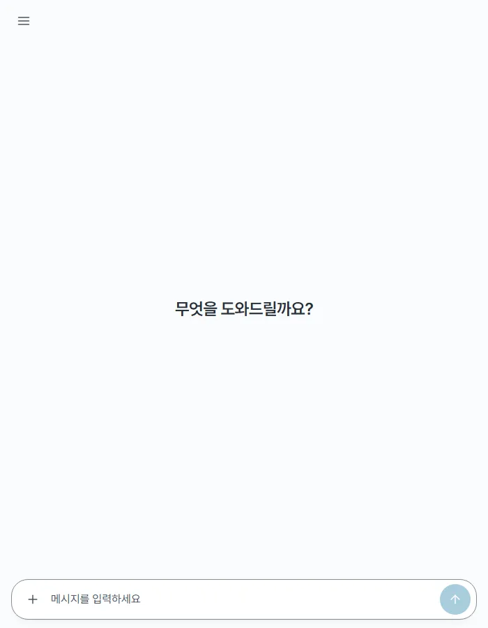
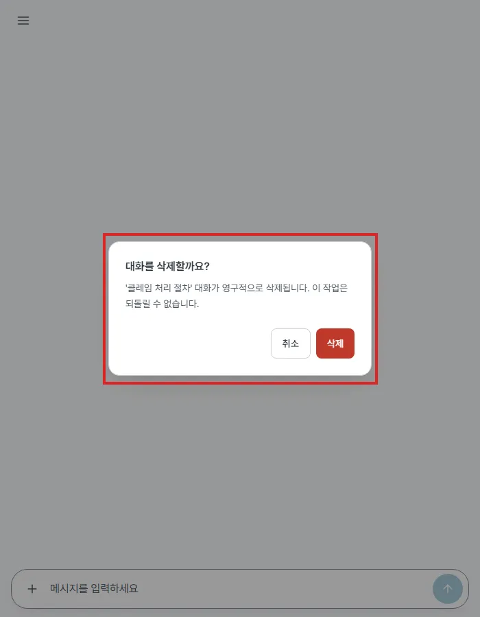

## #674 포커스 · inert 후속 — 전후

### 바꾼 것
- **확인 창(`ConfirmModal`)을 `document.body` 아래에 그린다(portal)** — 데스크톱 사이드바(`hidden md:block`) 안에서 띄운 대화 삭제 확인 창이 폭 768px 아래에서 조상째 숨어 안 보이는데 바깥 inert 는 남아 앱이 먹통이던 것(MAJOR). body 아래면 늘 보이고 inert 는 앱 뿌리 하나에 걸려, 드로어가 먼저 닫혀도(회전) 확인 창이 떠 있는 동안 뒤 화면이 열리지 않는다(MINOR 2). React 이벤트는 컴포넌트 트리를 따라 올라가 드로어의 Esc 판정은 그대로
- **Safari 포커스 복귀** — 클릭이 버튼에 포커스를 주지 않아 연 요소가 body 로 잡히던 것. `useModalFocus` 가 직전(1초 안)에 누른(pointerdown) 포커스 대상을 연 요소로 쓴다
- **삭제 표시 정리** — 삭제가 실패해 행이 남으면 표시를 거둬, 나중에 다른 경로로 그 행이 빠질 때 「새 대화」로 포커스가 튀지 않게
- 모달 틀 공통화 없음 · #253 그대로(#105 판정)

### 브라우저 탐침 (`p674.mjs`, 목업 API)

| 시나리오 | 전 | 후 |
|---|---|---|
| A. 1440 에서 대화 삭제 확인 창 → 700 폭 | 확인 창 **안 보임** · inert 6 · 입력창 막힘 · 누를 곳 없음 | 확인 창 보임 · inert 1(앱 뿌리) · 취소 → inert 0 · 입력창 열림 |
| C. Safari 흉내(포커스 없이 눌러 열고 Esc) — 데스크톱 | 포커스 BODY | 누른 삭제 버튼 |
| C. 같은 것 — 모바일 드로어 안 | 포커스 BODY · 그 뒤 Esc 로 드로어 **안 닫힘** | 누른 삭제 버튼 · Esc 로 드로어 닫힘 |

| 전(700 폭) | 후(700 폭) |
|---|---|
|  |  |

- B(드로어 + 이동 확인 창에서 회전)와 D(삭제 실패 뒤 다른 경로로 행이 빠짐)는 목업으로 답변 중 상태 · 목록 갱신이 재현되지 않아 **단위 테스트로 지킨다** — 아래 4개는 고치기 전 코드에서 모두 실패, 고친 뒤 통과(변형 검사)
  - ConfirmModal : 숨은 조상 안에서 띄워도 body 바로 아래 · 앱 뿌리 inert / 바깥 창이 먼저 닫혀도 inert 유지
  - useModalFocus : 포커스 없이 눌러 열어도 닫히면 누른 버튼으로
  - Sidebar : 삭제 실패 뒤 나중에 행이 빠져도 포커스를 옮기지 않음

### 확인
- vitest 382 → 386 · lint · tsc · build · `check-all.sh docs` 통과
- 원자료 : `before/probe.json` · `after/probe.json` · 탐침 `p674.mjs`(토큰은 실행 때 생성)
