## #675 화면 · 상태 후속 — 전후 증거

브랜치 `fix/675-screen-state-followup` · 커밋 `ec530a48`

### 바꾼 것

1. **대화 삭제 아이콘 X → 휴지통**(사용자 11-10 결정) — 전체 화면 드로어(#669)의 닫기 X 와 같은 모양이라 헷갈렸다. `icons.tsx` 에 같은 선 굵기(1.8)의 `IconTrash` 를 그려 사이드바(데스크톱 · 드로어 공통) 삭제 버튼에 쓴다. aria-label 그대로
2. **입력칸 `min-w-0`** — flex 항목의 최소 폭이 내용 기준(`field-sizing:content`)이 되어 공백 없는 긴 글이 보내기 버튼을 밀 수 있었다(리뷰 지적). Chromium 에서는 줄바꿈 덕에 재현되지 않았고(아래 측정 전후 같음) 방어로 넣었다. field-sizing 을 모르는 브라우저는 폭이 바뀌면(회전 · 사이드바 폭 조절) 높이를 다시 잰다(ResizeObserver, 폭만 봄)
3. **목록을 못 불러왔으면 「대화가 없습니다」가 아니라 「대화 목록을 불러오지 못했습니다 · 다시 시도」** — 오류 배너는 새 대화 · 대화 선택이 걷어 가는데, 그 뒤 사이드바가 「없다」고 말했다. `useChat` 에 `conversationsFailed` · `retryConversations`(다시 읽는 동안 스켈레톤)
4. **관리 화면 「다시 시도」 진행 표시** — 다시 읽는 동안 버튼을 막고 「다시 읽는 중…」(`AdminErrorBanners`, 문서 · 사용자 공통)
5. NIT : 「새 대화」 hover `canvas`(흰 면과 1.02:1) → `surface` · 프로필 메뉴 배경 막 z-10 → z-20(손잡이 z-10 보다 위 — 같은 층이면 손잡이 자리를 눌러도 메뉴가 안 닫혔다) · `IconSettings` 원 속을 면 색으로 메우던 것을 선 끊기로(hover 배경에 흰 원판) · 복사 문구를 비웠다가 다시 채워 두 번째 복사도 낭독 · 테스트의 `navigator.clipboard` 설정 되돌리기

### 측정 (`cap675.mjs`, 목업 API · 같은 빌드 조건)

| 항목 | 데스크톱 1440 전 → 후 | 모바일 390 전 → 후 |
|---|---|---|
| 삭제 아이콘이 닫기 X 와 같은 그림 | 예 → 아니오 | 예 → 아니오(드로어 닫기는 X 그대로) |
| 목록 실패 때 사이드바 | 「대화가 없습니다」 → 「불러오지 못했습니다」 | 같음 |
| 새 대화로 오류 배너가 걷힌 뒤 | 「대화가 없습니다」 → 「불러오지 못했습니다」 + 다시 시도 | 같음 |
| 다시 시도 뒤 목록 | (버튼 없음) → 2건 | (버튼 없음) → 2건 |
| 관리 「다시 시도」 누른 직후 | 「다시 시도」 · 눌림 → 「다시 읽는 중…」 · 막힘 | 같음 |
| 200자 URL 입력 뒤 보내기 버튼 | 입력줄 안 → 안(변화 없음) | 입력줄 안 → 안(변화 없음) |
| 메뉴 연 채 손잡이 자리 클릭 | 메뉴 안 닫힘 → 닫힘 | (손잡이 없음) |
| 「새 대화」 hover 배경 | `#FBFCFE`(흰 면과 거의 같음) → `#EDF2F8` | (터치라 hover 없음) |

원자료 : `before/probe.json` · `after/probe.json`

### 화면 (after 의 빨간 박스 = 바뀐 자리)

| | 전 | 후 |
|---|---|---|
| 모바일 사이드바 | 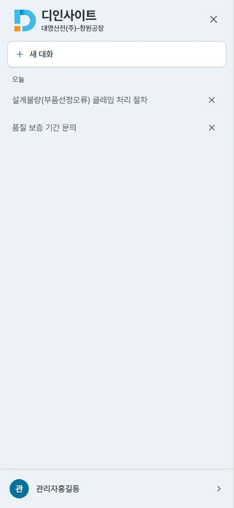 | 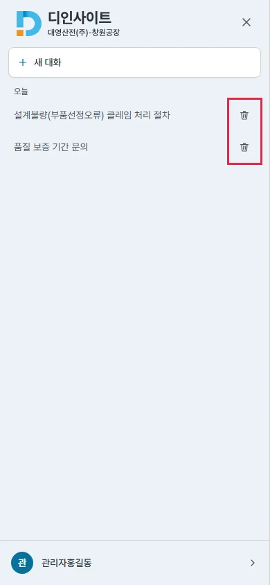 |
| 모바일 목록 실패 | 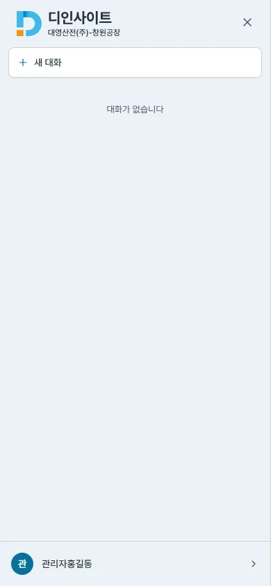 | 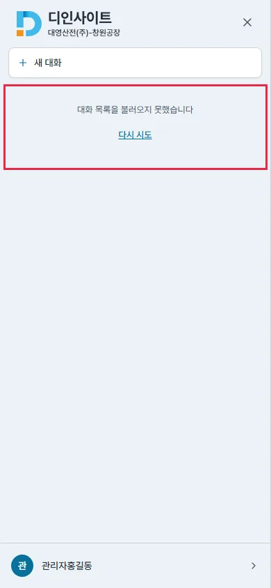 |
| 데스크톱 목록 실패 | 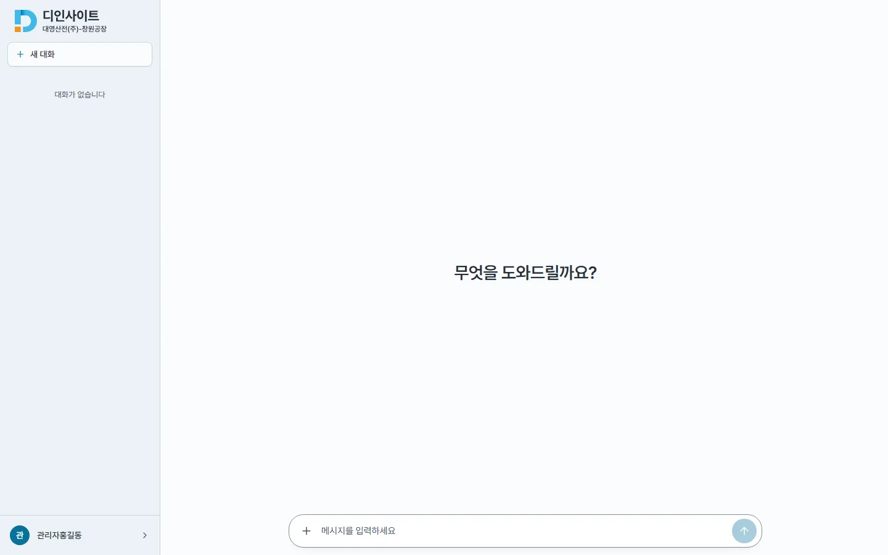 | 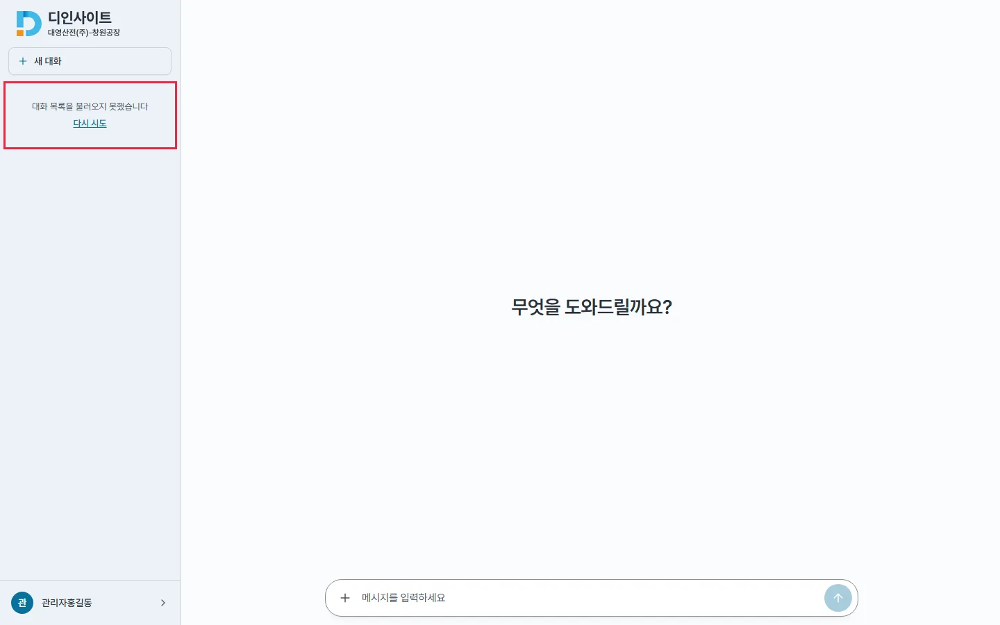 |
| 데스크톱 관리 다시 시도 | 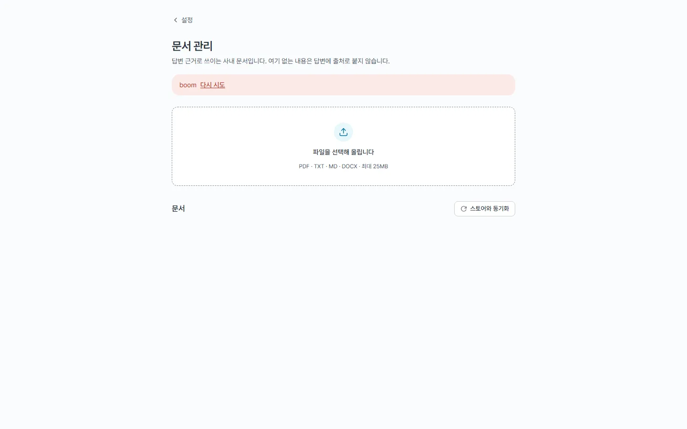 | 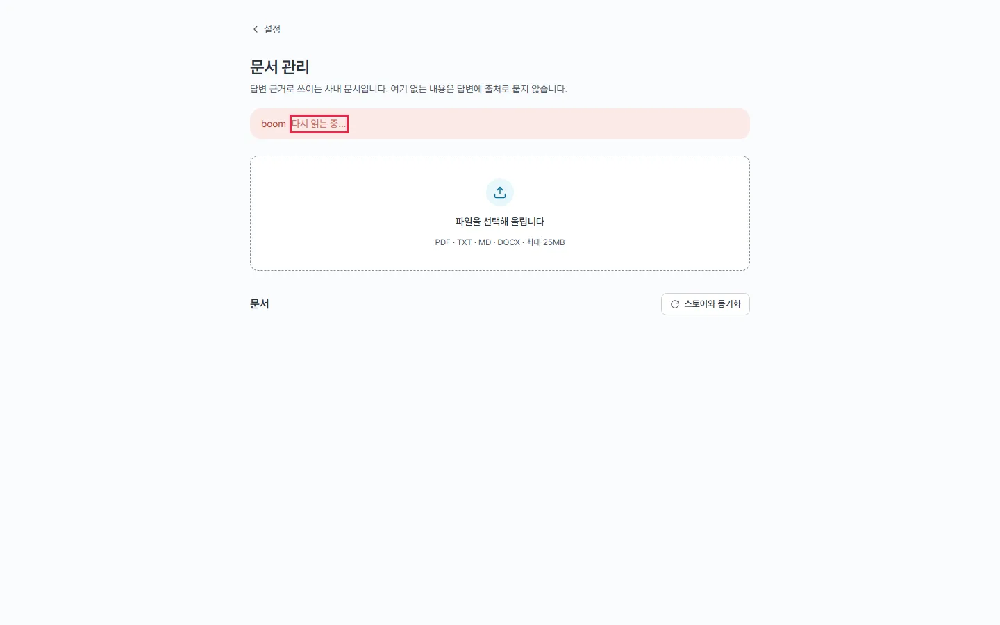 |
| 모바일 관리 다시 시도 | 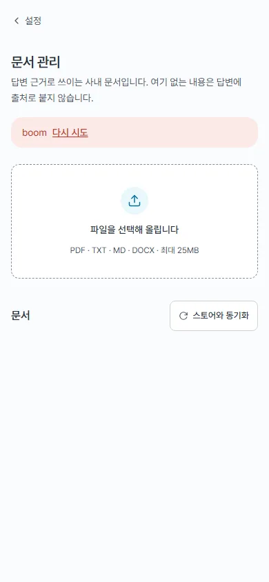 | 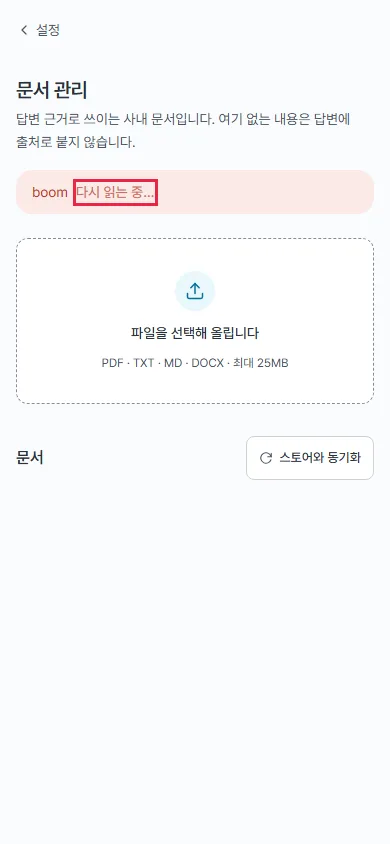 |
| 데스크톱 프로필 메뉴 hover | 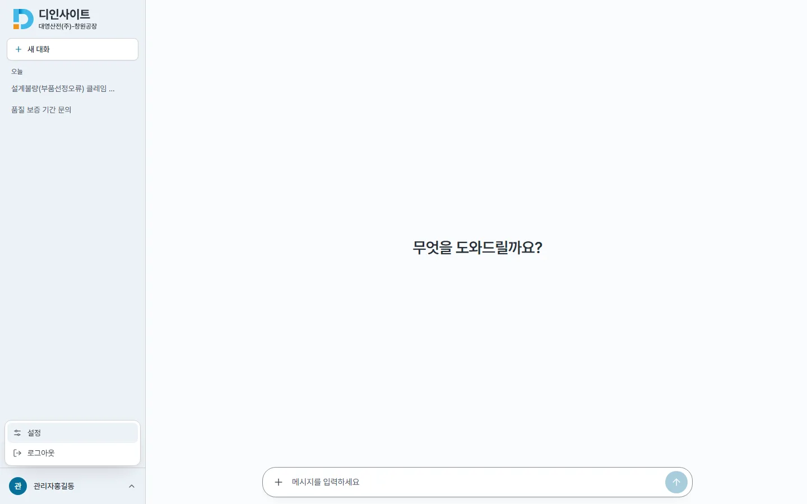 | 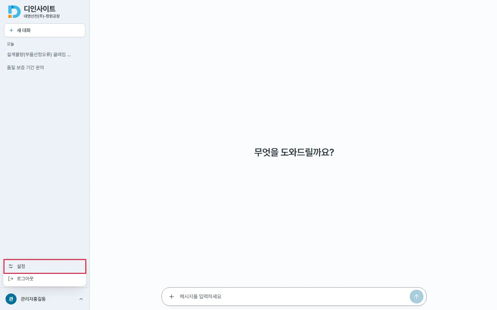 |
| 데스크톱 긴 URL | 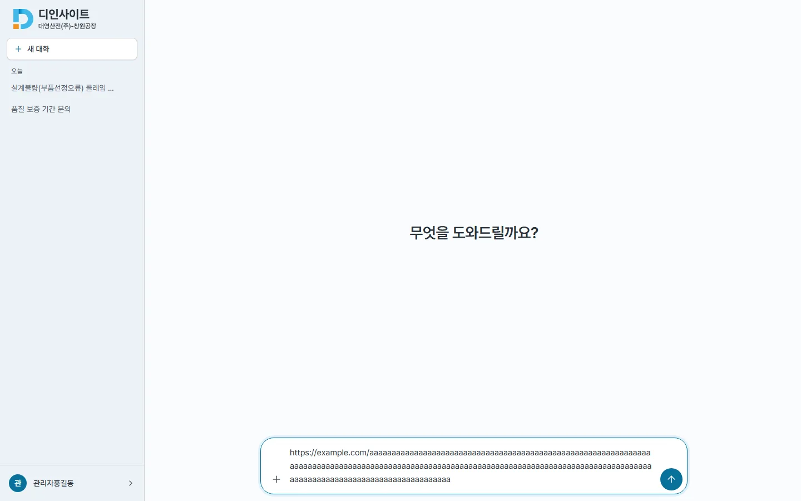 | 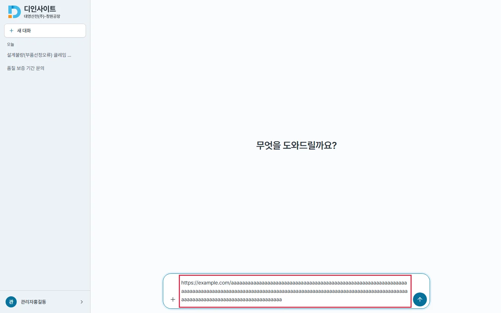 |
| 모바일 긴 URL | 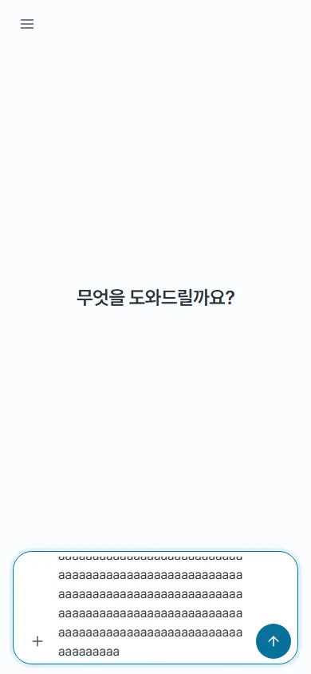 | 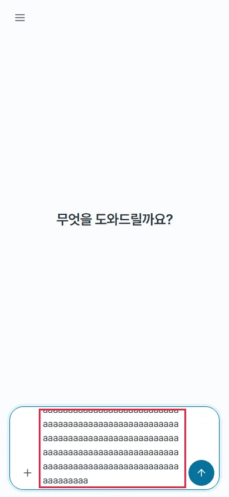 |
| 데스크톱 사이드바(삭제 버튼은 hover 때만 보임) | 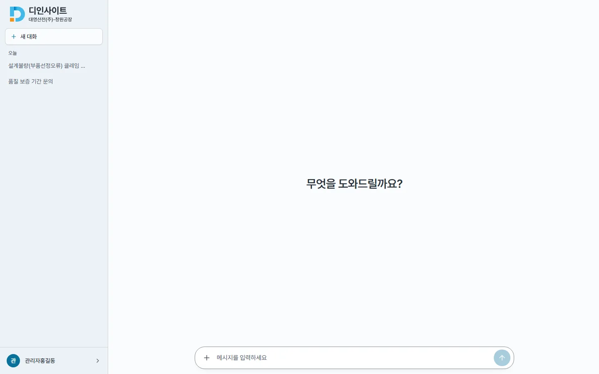 | 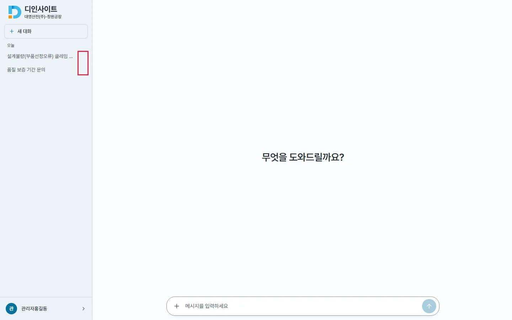 |

### 확인

- `npm run lint` · `tsc` · `npm run build` 통과 · vitest 382 → 392(+10 : useChat 2 · Sidebar 3 · Composer 2 · AdminErrorBanners 2 · 복사 1)
- `bash scripts/check-all.sh docs` 통과 · `design-system.md` 동기화(아이콘 규칙 · 삭제 휴지통 · 목록 실패 · 다시 시도)
