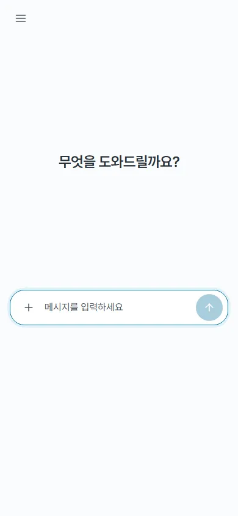
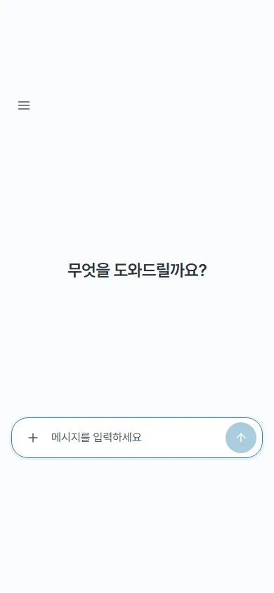
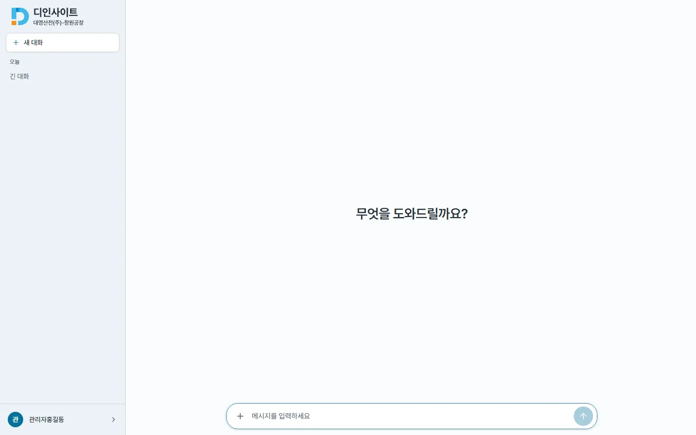

## #687 iOS 키보드 열림 — 전후

**원인(가설)** : #682 는 키보드 높이를 `focusin` 에서 미리 줄였다. 그런데 focusin 은 Safari 가 「입력칸을 보이게 밀지」 정한 뒤에 온다. 그래서 루트가 줄어든 위에 Safari 의 밀기가 겹쳐 입력칸이 위 끝까지 갔다가 내려왔다(매번).

**수정** (`frontend/src/pages/ChatPage.tsx`)
1. 기억한 키보드 높이만큼 **입력칸을 누르는 순간**(`touchstart` · `pointerdown`, 포커스 전) 미리 줄인다. 조건(확대 중 아님 · 채팅 화면의 텍스트 입력 · 키보드 아직 안 뜸)은 그대로 둔다. 누르고 600ms 안에 포커스가 오지 않으면(끌기 등) 되돌린다. focusin 경로는 키보드 · 프로그램 포커스를 위해 남겼다.
2. 키보드가 떠 있는 동안 보이는 영역이 밀리면(`visualViewport.offsetTop > 0`, 문서 스크롤이 꺼져 있어 `scrollTo` 로는 안 돌아옴) 루트를 `translateY(offsetTop)` 로 따라 내린다. 닫힐 때와 확대 중에는 푼다.
   - 근거 : [WebKit 218465](https://bugs.webkit.org/show_bug.cgi?id=218465)(offsetTop 은 밀기가 끝난 뒤 갱신) · [WebKit 191204](https://bugs.webkit.org/show_bug.cgi?id=191204)(키보드가 떠 있는 동안 뷰포트 계산이 어긋남)
   - 그래서 2 는 보정이고, 주된 처방은 1 이다.

**측정**(가짜 visualViewport, 키보드 300px 을 한 번 배운 뒤 · `m687.mjs`)

| 시점 | 모바일 390 전 | 모바일 390 후 | 데스크톱 1440 전 → 후 |
|---|---|---|---|
| 누르는 순간(포커스 전) | 844px(안 줄어듦) | **544px** | 비어 있음 → 비어 있음 |
| 포커스 뒤 | 544px | 544px | 비어 있음 → 비어 있음 |
| 키보드 떠 있는 채 120px 밀림 | transform 없음 | **translateY(120px)** | 해당 없음 |
| 닫은 직후 | 비어 있음 | 비어 있음(transform 도 풀림) | 비어 있음 → 비어 있음 |
| React 커밋 · 문서 scrollTop | 0 · 0 | 0 · 0 | 0 · 0 |

| | 전 | 후 |
|---|---|---|
| 모바일 390 |  |  |
| 데스크톱 1440 |  |  |

화면 모양은 두 폭 모두 같다(회귀 없음). 헤드리스는 가상 키보드와 Safari 의 실제 밀기를 재현하지 못하니 **체감은 아이폰 실기기로 확인해야 한다**.

**검증** : vitest 404/404(새 테스트 5) · lint 0 · build · docs 게이트 통과
