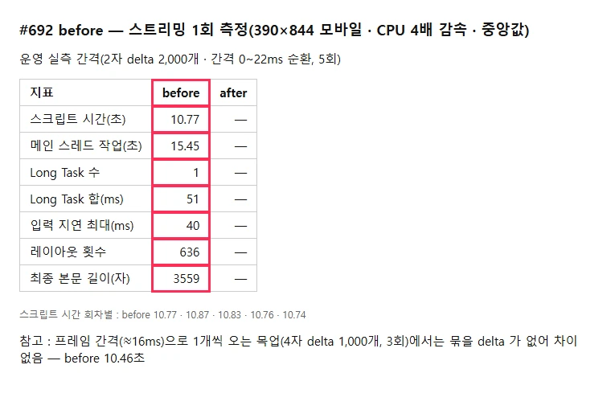
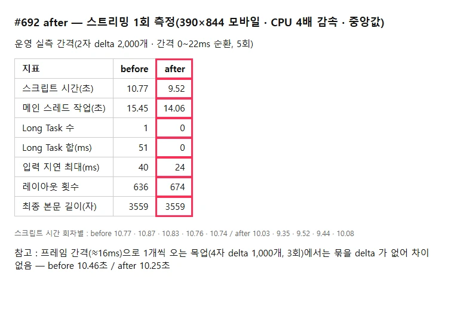
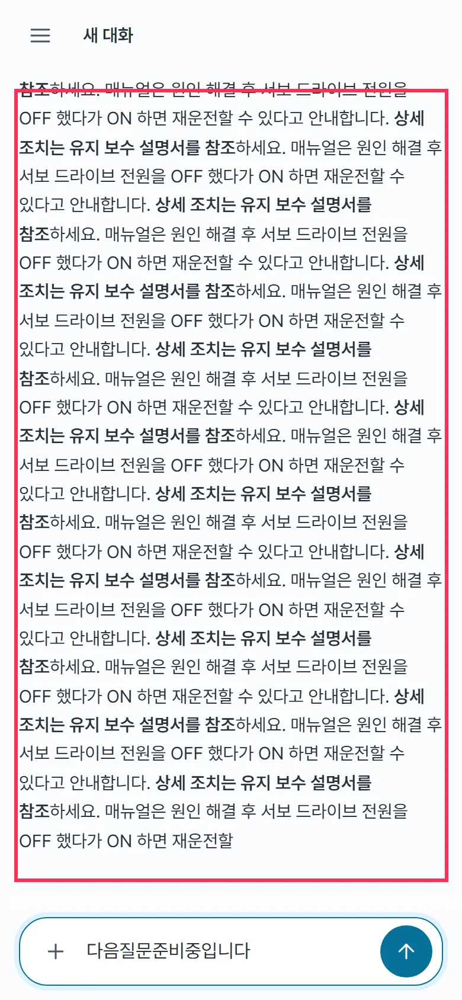

## 작업 요약

`useChat.ts` `onToken` 이 delta 마다 `setMessages` 하던 것을 `requestAnimationFrame` 으로 모아 **프레임마다 한 번만** 반영한다. 완료 · 오류 · 중단(catch)에서는 남은 delta 를 먼저 반영해 글자 유실과 빈 답 오판을 막는다.

- 커밋 : `5f5ce4e5` perf(frontend): 스트리밍 delta 를 프레임마다 한 번만 반영한다 (#692)
- 브랜치 : `feat/692-issue-692`

## 측정 조건 — 운영 실측에 맞춤

운영 `POST /api/chat` 한 턴을 재 보니 token 이벤트 1,248개 · 2,196자 · 10.5초, **네트워크 묶음당 1.16개(대부분 따로 도착)**, 간격 중앙 5.75ms · 58% 가 8ms 미만 → 한 프레임(16ms)에 delta 가 평균 2개 남짓 따로 온다. 목업 SSE 를 이 분포(2자 delta 2,000개 · 간격 0~22ms 순환)로 맞추고 390×844 모바일 · CPU 4배 감속 · 5회 중앙값으로 쟀다.

## 변경 전후

| before | after |
|---|---|
|  |  |
|  |  |

| 지표 | before | after |
|---|---|---|
| 스크립트 시간 | 10.77초 | **9.52초 (−12%)** |
| 메인 스레드 작업 | 15.45초 | 14.06초 (−9%) |
| Long Task | 1개 · 51ms | **0개** |
| 입력 지연 최대 | 40ms | 24ms |
| 최종 본문 | 3,559자 | 3,559자 (같음) |

- 회차별 스크립트 시간 : before 10.74~10.87 · after 9.35~10.08 — 범위가 겹치지 않음
- **악화 · 한계도 적는다** : 레이아웃 횟수는 636 → 674(오차 범위로 봄). 프레임 간격으로 1개씩 오는 목업(Windows 타이머 ≈15.6ms)에서는 묶을 delta 가 없어 차이 없음(10.46 → 10.25초). 남은 스크립트 시간 대부분은 마크다운 재파싱이 아닌 곳(SSE 해석 · 애니메이션 등)으로 보임 — 효과는 확실하지만 크지 않다

## 변경 파일

- `frontend/src/hooks/useChat.ts` — `pendingDelta` · `frame` · `flushDelta`, onDone · onError · catch 맨 앞에서 flush
- `frontend/src/hooks/useChat.test.ts` — #692 케이스 4건(한 프레임 묶음 · 완료 · 오류 · 프레임 전 중단)

## 검증

- `npm run lint` · `tsc -b` · `vitest run` 411 passed(종료 코드 0) · `vite build`
- 핵심 케이스(한 프레임 묶음)는 변경 전 코드에서 실패 확인 · 나머지 3건은 글자 유실 회귀 방지
- 측정 스크립트 · 원본 수치 : `.issue/692/evidence/`(server.mjs · measure.mjs · \*.json)

## 남은 이슈

- 숨은 탭에서는 rAF 가 멈춰 화면 반영이 미뤄진다 — 완료 · 오류 · 중단 때 flush 되므로 최종 표시 · 저장 결과는 같다
- 실기기(저사양 모바일) 체감은 미측정
