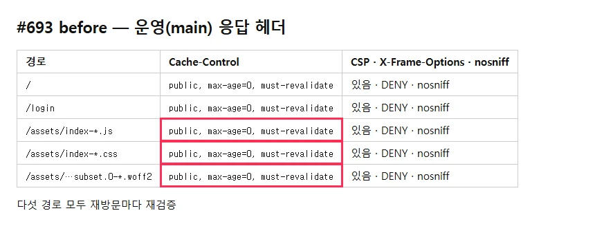
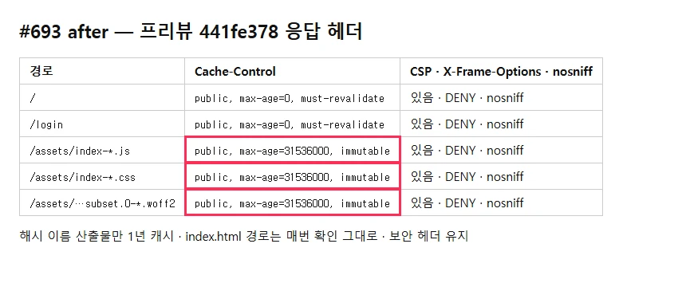

## 작업 요약

`frontend/vercel.json` 에 `/assets/(.*)` → `Cache-Control: public, max-age=31536000, immutable` 규칙을 추가했다. 빌드 산출물은 이름에 내용 해시가 붙어 영구 캐시가 안전하다. `/` · 라우트(index.html)는 Vercel 기본값(매번 확인) 그대로, 기존 보안 헤더 규칙도 그대로다.

- 커밋 : `441fe378` perf(frontend): /assets 정적 파일에 1년 immutable 캐시 헤더 (#693)
- 브랜치 : `feat/693-issue-693`

## 변경 전후

| before (운영 main) | after (프리뷰 441fe378) |
|---|---|
|  |  |

- before : 다섯 경로 모두 `public, max-age=0, must-revalidate` — 재방문마다 렌더를 막는 CSS · 메인 JS 까지 재검증
- after : `/assets` 의 js · css · woff2 만 `max-age=31536000, immutable`, `/` · `/login` 은 `max-age=0` 유지, **다섯 경로 모두 CSP · DENY · nosniff 유지**
- 원본 : `.issue/693/evidence/before/headers.txt`(운영 curl) · `after/headers.txt`(프리뷰)

## 변경 파일

- `frontend/vercel.json` — 헤더 규칙 1개
- `docs/02_architecture/frontend.md` 「배포 (Vercel)」 — 캐시 근거 · index.html 은 매번 확인 · 옛 청크 대체
- `docs/06_changelog/CHANGELOG.md` — `[Unreleased]` Performance

## 검증

- vercel.json JSON 유효 · `check-all.sh docs` 통과 · Vercel 프리뷰 배포 성공
- 프리뷰는 Vercel 보호가 걸려 curl 이 302 → 사용자 Chrome 세션에서 같은 출처 `fetch(cache: 'no-store')` 로 헤더를 읽음

## 남은 이슈

- 재방문 첫 화면 시간 단축은 미측정(헤더로 재검증이 사라지는 것까지만 확인) — 운영 반영 뒤 재방문 네트워크 패널에서 `/assets` 가 304 없이 메모리/디스크 캐시로 오는지 확인 권장
- CHANGELOG `[Unreleased]` 맨 위는 #696(#692)과 충돌한다 — merge 순서대로 합칠 때 양쪽 보존
