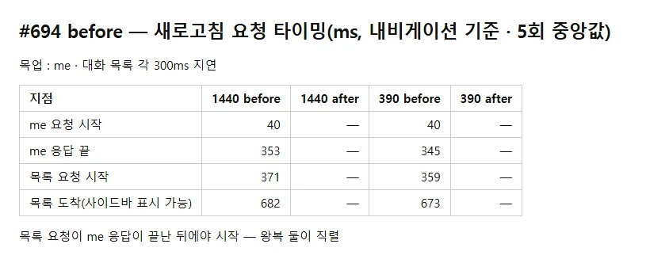
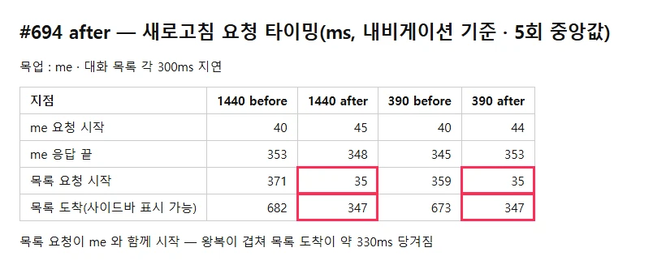
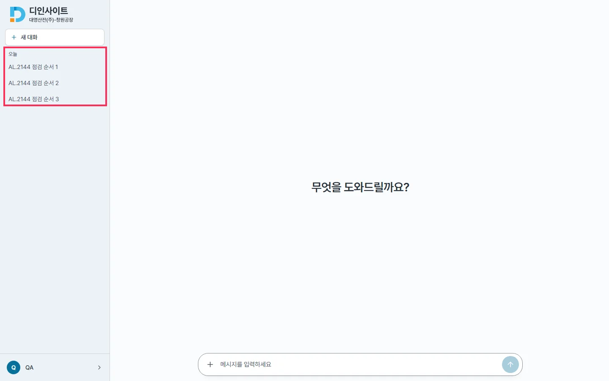

## 작업 요약

새로고침 때 대화 목록 요청을 `/api/auth/me` 와 함께 시작한다. 이전에는 me 응답 → ProtectedRoute 가 채팅 화면을 그림 → `useChat` 이 목록 요청으로, 왕복 둘이 직렬이었다.

- `frontend/src/lib/conversationPrefetch.ts` : 토큰이 있으면 `listConversations()` 를 시작하고 주인(`tokenSubject`) · 시각을 기억. `takePrefetchedConversations()` 는 **한 번만**, 같은 계정이고 10초 안일 때만 돌려준다(#617 계정 경계 · 설정 화면에 머물다 온 경우는 새로 받음). 쓰이지 않은 실패가 unhandled rejection 으로 남지 않게 막음
- `main.tsx` 가 기동 때 호출(처음엔 AuthProvider 에 넣었으나 endpoints 를 목업하며 listConversations 를 빼 둔 기존 테스트(MyPage · AdminDocumentsPage 등)가 깨져, 기동 지점으로 옮김 — 더 일찍 시작하기도 함)
- `useChat` 첫 로드 : `takePrefetchedConversations() ?? listConversations()`

- 커밋 : `2d43e17d`(코드) · `87b6577e`(문서 · CHANGELOG · 프론트 케이스 하한 407 → 415)
- 브랜치 : `feat/694-issue-694`

## 변경 전후

| before | after |
|---|---|
|  |  |
|  |  |

목업(me · 목록 각 300ms 지연), 1440 · 390, 5회 중앙값 :

| 지점(ms) | 1440 before | 1440 after | 390 before | 390 after |
|---|---|---|---|---|
| 목록 요청 시작 | 371 (me 응답 뒤) | **35** | 359 | **35** |
| 목록 도착 | 682 | **347** | 673 | **347** |

- 사이드바 목록 표시 결과는 전후 같다(박스)
- 실제 단축 폭은 운영 왕복 시간만큼 — 운영 왕복은 미측정(목업 300ms 가정)

## 변경 파일

- `frontend/src/lib/conversationPrefetch.ts`(새) · `frontend/src/main.tsx` · `frontend/src/hooks/useChat.ts`
- 테스트 : `lib/conversationPrefetch.test.ts` 6건(토큰 없음 · 한 번만 · 다른 계정 · 같은 계정 재발급 · 10초 지남 · 미사용 실패) · `hooks/useChat.test.ts` 2건
- 문서 : `frontend.md` 상태 표 · CHANGELOG · `case-floors.env`

## 검증

- lint · `tsc -b` · vitest 415 passed(종료 코드 0) · build · docs 검사
- 핵심 케이스(미리 받은 것을 쓰면 마운트 때 다시 요청 안 함)는 변경 전 useChat 에서 실패 확인

## 남은 이슈

- me 가 401 이면 미리 받은 목록 요청도 401 — 같은 `handleUnauthorized` 경로라 동작 변화 없음(토큰 폐기 → 로그인)
- 개발 모드 StrictMode 는 첫 로드 효과가 두 번 돌아 두 번째는 새로 요청한다(운영 무관)
- CHANGELOG `[Unreleased]` 맨 위 · `case-floors.env` 는 #696 · #697 과 충돌 — merge 순서대로 합치며 하한은 그때 실측
