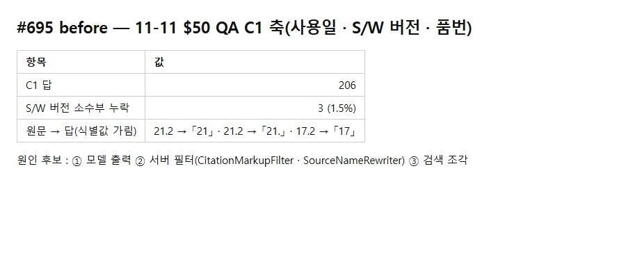
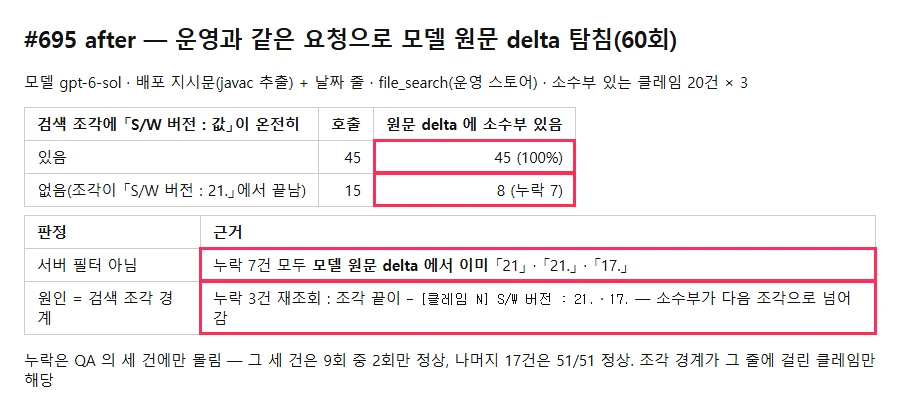

## 판정 — 서버 필터가 아니라 Vector Store 검색 조각 경계

11-11 $50 QA 의 S/W 버전 소수부 누락(206건 중 3건, 21.2 → 「21」 · 「21.」, 17.2 → 「17」)을 운영과 같은 요청으로 다시 보내 **모델 원문 delta** 를 저장했다.

| before (QA 관찰) | after (원문 탐침 60회) |
|---|---|
|  |  |

- 탐침 : 모델 gpt-6-sol · 배포 지시문(`RAG_INSTRUCTIONS` 를 javac 로 뽑아 운영 문자열과 같게) + 날짜 줄 · file_search(운영 스토어) · `include: file_search_call.results` — `OpenAiRealService.streamChat` 와 같은 본문. 소수부 있는 클레임 20건(QA 누락 세 건 포함) × 3
- **서버 필터 아님** : 누락 7건 모두 OpenAI 가 보낸 `response.output_text.delta` 를 이어 붙인 원문에서 이미 「21」 · 「21.」 · 「17.」 — `CitationMarkupFilter` · `SourceNameRewriter` 를 거치기 전이다
- **원인 = 조각 경계** : 검색 조각에 「S/W 버전 : 값」이 온전히 있으면 45/45 정답, 없으면 15회 중 8회만 정답(누락 7). 누락 세 건을 다시 조회해 조각 원문을 보니 조각이 `- [클레임 N] S/W 버전 : 21.` · `17.` 에서 **끝난다** — 소수부가 다음 조각으로 넘어가고, 그 조각은 서비스번호가 없어 함께 검색되지 않는다
- 누락은 QA 의 세 건에만 몰렸다 : 그 세 건 9회 중 2회만 정답, 나머지 17건은 51/51
- #653(입고일자 누락)과 같은 계열 — 그때는 요약 줄에 입고일자를 올려 해결했다

## 비용 · 보안

- OpenAI 직접 호출 63회(60 + 조각 저장 재조회 3) · 입력 약 144만 토큰 ≈ $2.7 추정
- 키는 서버에서 임시 파일로 받아 실행 직후 지움 · 운영 앱 · DB 는 건드리지 않음
- 서비스번호 · S/N · 조각 원문 · 답 원문은 저장소에 넣지 않았다(#653 과 같은 기준) — QA 자료 폴더 `results/2026-11-11-695/` 에 둠. 저장소에는 식별값을 뺀 탐침 스크립트(`.issue/695/evidence/probe.py`)만

## 결론과 제안

- 코드 수정 없음(필터 원인이 아니므로 완료 기준의 「재현 단위 테스트」는 해당 없음)
- 고치려면 #653 과 같은 방식 : 클레임 전처리(`scripts/claims/preprocess.py`)에서 **요약 줄에 S/W 버전을 올리고** 운영 Vector Store 문서를 교체한 뒤, 같은 탐침 · 배터리로 전후를 잰다 — 별도 이슈로 제안
