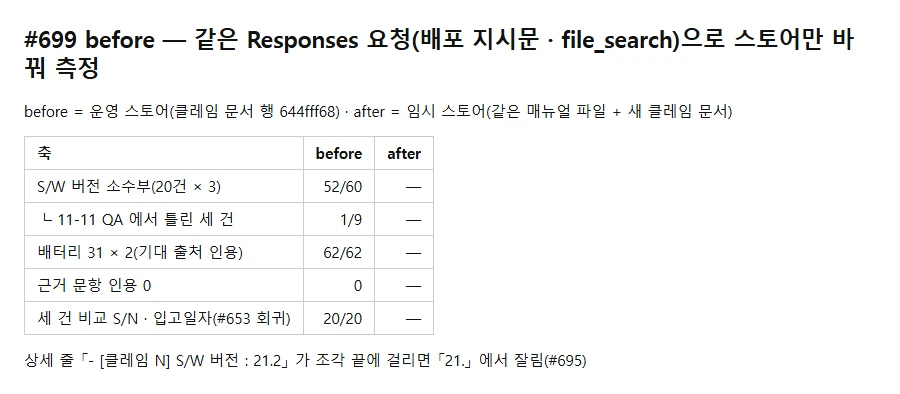
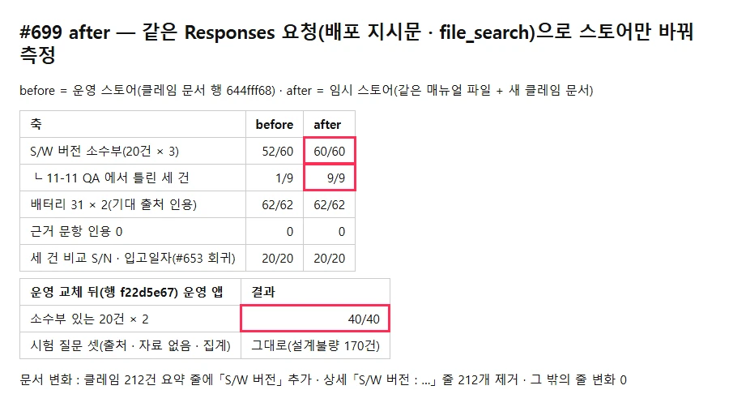

## 작업 요약

클레임 전처리(`scripts/claims/preprocess.py`)가 **S/W 버전을 클레임 요약 줄로 옮긴다**. 상세의 「S/W 버전 : 21.2」 줄이 검색 조각 끝에 걸리면 「21.」 에서 잘려 모델이 「21」 로 답했다(#695). 요약 값은 상세에 다시 적지 않는 규칙(#467)을 따라 상세 줄은 빠진다(이슈 초안의 「상세 줄 그대로」에서 바꿈 — 중복이 매뉴얼 조각을 밀어낸 전례).

- 커밋 : `5a5cc551`(전처리) · `9510f471` · `3aa984ab`(live-integration.md · CHANGELOG)
- 산출물 : 이전 판과 바이트 비교 — 요약 줄 212개에 「S/W 버전」 추가 · 상세 S/W 줄 212개 제거 · 그 밖의 줄 변화 0(264,726 → 261,018B). 이전 판은 운영 문서와 바이트까지 같음을 먼저 확인

## 변경 전후

| before | after |
|---|---|
|  |  |

- 측정 : 배포 지시문(javac 추출) + 날짜 줄 · file_search · include results — `OpenAiRealService.streamChat` 와 같은 본문으로 **스토어만** 바꿈. before = 운영 스토어, after = 임시 스토어(운영 매뉴얼 file_id 재사용 + 새 클레임 문서), 동시에 실행
  - S/W 소수부 52/60 → **60/60**(QA 세 건 1/9 → **9/9**) · 배터리 31 × 2 62/62 → 62/62 · 근거 문항 인용 0 0 → 0 · 세 건 비교(#653) 20/20 → 20/20
- **운영 교체** : 관리자 API 로 새 문서 업로드(행 `f22d5e67`, completed) → 옛 행 `644fff68` 삭제(204). 되돌리기 = 자료 폴더 `필드클레임현황-pre699.md` 를 같은 방법으로 올리고 새 행 삭제
- 교체 뒤 운영 앱(시험 사용자 2명) : 소수부 있는 20건 × 2 **40/40** · 43턴 완료 · 시험 질문 셋(출처 붙음 · 자료 없음 noSource · 집계 「설계불량 170건」) 그대로 · 앱 로그 WARN/ERROR 0

## 비용 · 정리

- OpenAI 직접 호출 284회 ≈ $12.3 + 운영 앱 43턴 ≈ $1.7
- 임시 스토어 · 업로드 파일 삭제(200) · 시험 사용자 삭제(204 × 2) · OpenAI 키 · JWT 임시 파일 삭제
- 식별값 · 답 원문은 QA 자료 폴더 `results/2026-11-11-699/` 에만. 저장소에는 식별값 없는 스크립트(m699.py · g699.py · store.py)

## 검증

- `check-all.sh docs` 통과 · 백엔드 · 프론트 코드 변경 없음(케이스 하한 그대로)
- 전처리 단위 테스트는 저장소에 전처리 테스트 틀이 없어 산출물 바이트 대조로 대신했다(이슈 완료 기준 1번의 대체 — 근거는 위 산출물 줄)
