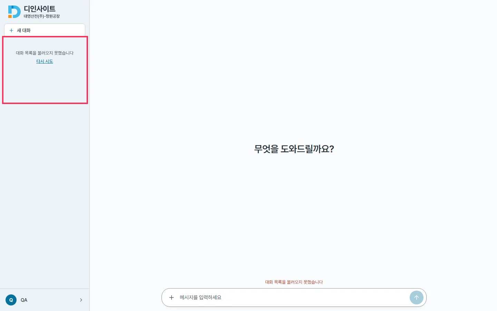
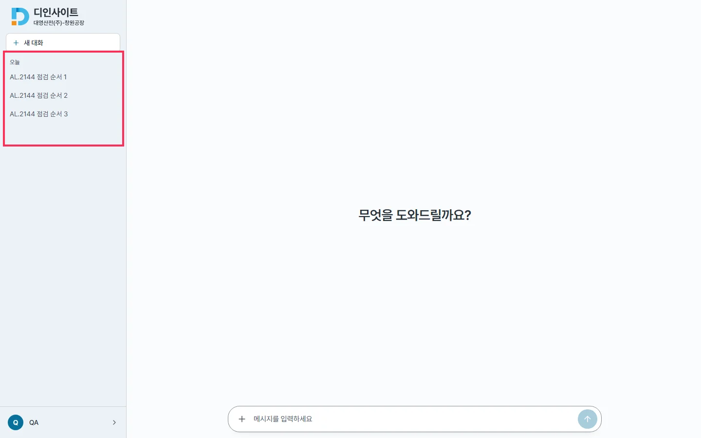
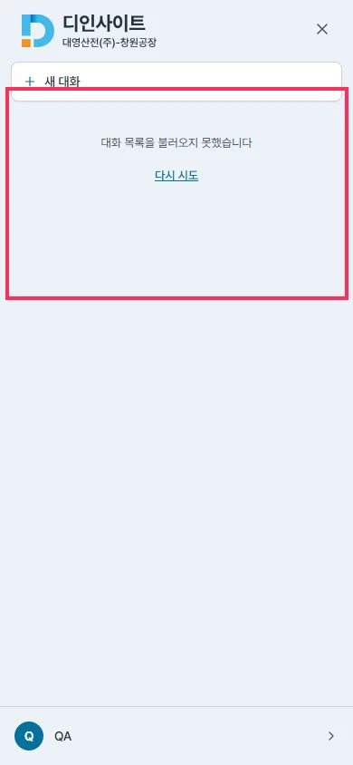
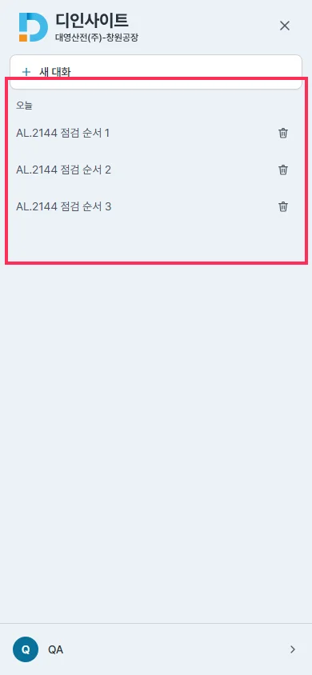

## 작업 요약

`takePrefetchedConversations()` 가 돌려주는 promise 에 `.catch(() => listConversations())` — 미리 받은 요청이 실패했으면 첫 로드가 목록을 새로 받는다. 커밋 `db1b8a07`(코드 · 테스트 1 · CHANGELOG · 하한 419 → 420).

## 변경 전후 — 목업 : 첫 `/api/auth/me` · 첫 `/api/conversations` 만 503(배포 재시작 순간), 이후 정상

| | before | after |
|---|---|---|
| 1440 |  |  |
| 390(드로어) |  |  |

- before : me 2회(재시도로 성공) · 목록 **1회** → 실패한 미리 받기를 그대로 써 「대화 목록을 불러오지 못했습니다」 + 입력창 위 오류 줄
- after : me 2회 · 목록 2회(실패 1 + 다시 받기 1) → 목록 표시 · 오류 없음
- 원본 : `before.json` · `after.json` · 재현 서버 `server.mjs` · 캡처 `cap.mjs`

## 검증

- 새 테스트 「미리 받기가 실패했으면 마운트 때 새로 받아 목록을 보인다」 — 변경 전 코드에서 실패 확인
- lint · tsc · vitest 420 passed(종료 코드 0) · 하한 실측 420/420 · docs 검사
