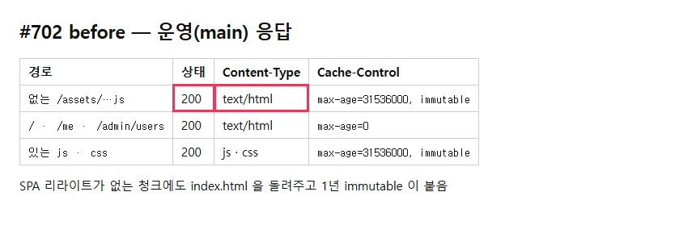
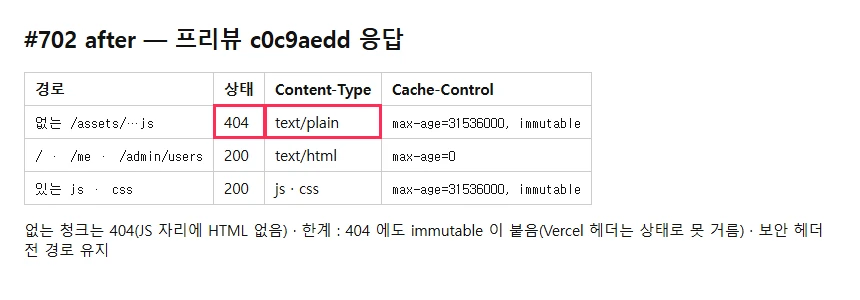

## 작업 요약

SPA 리라이트 source 를 `/((?!assets/).*)` 로 바꿔 없는 `/assets/*` 가 `index.html` 대신 404 를 받게 했다. 커밋 `c0c9aedd`(vercel.json · frontend.md) · `c4f02087`(한계 · CHANGELOG).

| before (운영) | after (프리뷰) |
|---|---|
|  |  |

- 없는 청크 : 200 text/html → **404**. `/` · `/me` · `/admin/users` 직접 열기는 200 index.html(`max-age=0`) 그대로 — SPA 라우팅 유지. 있는 js · css immutable · 보안 헤더(CSP · DENY) 전 경로 유지
- **한계(그대로 남음)** : 404 에도 `max-age=31536000, immutable` 이 붙는다. Vercel 헤더 규칙은 응답 상태로 조건을 걸 수 없다. 옛 탭이 찾은 청크의 404 를 브라우저가 붙잡은 뒤 롤백으로 그 해시가 되살아나면, 하드 리로드 전까지 마크다운이 평문으로 남을 수 있다 — 사용자 결정으로 이 한계는 frontend.md 에 적고 진행
- 원본 : `before/headers.txt`(운영 curl) · `after/headers.txt`(프리뷰, Chrome 세션 fetch — 프리뷰는 Vercel 보호)

## 검증

- vercel.json JSON 유효 · docs 검사 · 프리뷰 배포 성공 · 코드 · 테스트 변화 없음
