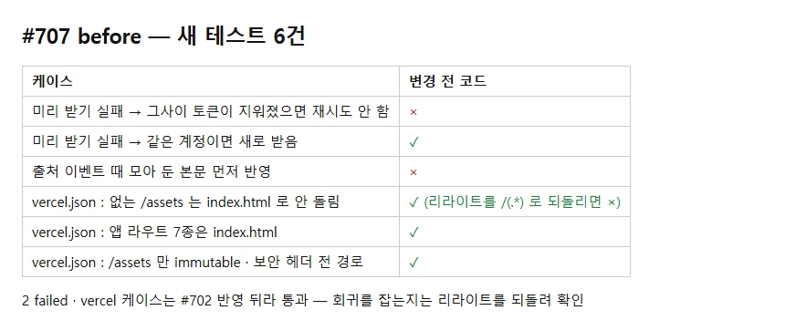
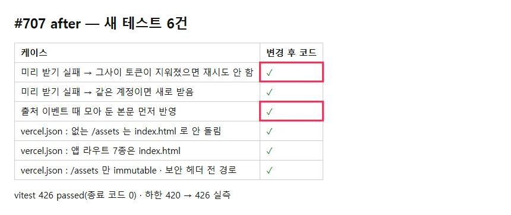

## 작업 요약

커밋 `c850f7f6`.
- `lib/conversationPrefetch.ts` : 재시도 직전 계정 재확인 — `tokenSubject() === owner` 일 때만 `listConversations()`, 아니면 원래 실패를 돌려준다
- `hooks/useChat.ts` `onCitations` : `flushDelta()` 먼저
- `src/vercel-config.test.ts`(새) : SPA 리라이트가 `/assets/` 를 빼는지 · 앱 라우트 7종 · `/assets` 만 immutable · 보안 헤더 전 경로
- CHANGELOG · 프론트 케이스 하한 420 → 426

## 변경 전후

| before | after |
|---|---|
|  |  |

- 변경 전 코드 : 새 케이스 2 실패(재시도 계정 · 출처 flush). vercel 케이스는 #702 뒤라 통과 — 리라이트를 `/(.*)` 로 잠시 되돌리면 「없는 /assets 청크는 index.html 로 돌리지 않는다」가 실패함을 확인(`before/vercel-revert.txt`)
- 변경 후 : vitest 426 passed(종료 코드 0) · lint · tsc · 하한 실측 426/426 · docs 검사
- 화면 · 운영 동작 변화 없음(경계 경우와 한 프레임 순서만)
