## 작업 요약

#730 독립 리뷰가 짚은 대로 성능 증거의 검사 두 개는 실패할 수 없는 구조였고, 문서 주장 네 곳은 측정이 받쳐 주지 않았습니다. 측정 하네스를 고친 판(`e732.mjs`)으로 바꿔 **853393cf(전) · e8415db4(후) 빌드를 장면 15개 × 15회** 다시 쟀고, 그 숫자로 design-system §4 · CHANGELOG 를 고쳤습니다. 동작 코드는 바꾸지 않았습니다(복사 알림 주석 한 줄).

## 하네스에서 고친 것

| 리뷰 지적 | 고친 방법 |
| --- | --- |
| 30ms 취소 클릭이 실제로는 애니메이션 뒤에 눌림(Playwright Stable 대기) | 페이지 안에서 등장 30ms 를 기다려 그 순간 버튼 좌표의 hit test · 누름 + 애니메이션 currentTime 기록 |
| 「화면에 붙기까지」 = DOM 부착 시간 | `attachMs`(DOM 부착)와 `settledMs`(대상 · 조상 애니메이션이 끝난 첫 프레임 = 눈에 보이는 완성)를 나눔 |
| 긴 작업 미측정 | `PerformanceObserver('longtask')` 실행마다 개수 · 최대 길이 |
| 실행별 값 · 횟수 미기록 | `runs`(실행별 전부) · `median` · `max` · `meta`(runs · freezeMs · 명령) |
| reduced-motion 검사가 공허 | 창 개수 + 카드 `animationName` · `animationDuration` |
| 박스 · opacity 가 애니메이션 대상이 아님 | 실제 움직이는 요소에서 실효 opacity(조상 곱) · scale · translate |
| 발급 창 열기 · 오류 배너 성능 미측정 | 장면 `issueOpen` · `bannerAction`(초기화 500) 추가 |
| CSS 크기 원자료 없음 | `css-size.json` : 85,389 → 85,873B(+484) · gzip level 9 22,284 → 22,412B(+128) |

## 다시 잰 결과 (중앙값, ms)

| 장면 | DOM 부착 | 눈에 보이는 완성 | Layout 횟수 | Layout 시간 | 스타일 Δ | 작업 Δ | longtask 최대 개수 전/후 |
| --- | ---: | ---: | ---: | ---: | ---: | ---: | ---: |
| 확인 창 (1440) | 18.7 → 19.1 | 18.7 → **225.7** | 2 → 3 | 2.81 → 2.87 | +0.88 | +2.54 | 0 / 0 |
| 사용자 메뉴 (1440) | 46.2 → 48.2 | 46.2 → **200.8** | 1 → 1 | 0.49 → 0.47 | +1.72 | +3.12 | 0 / 0 |
| 라이트박스 (1440) | 44.5 → 43.4 | 44.5 → **251.4** | 3 → 3 | 0.44 → 0.46 | +0.84 | +3.47 | 0 / 0 |
| 드래그 오버레이 (1440) | 11.7 → 10.6 | 11.7 → **187.7** | 2 → 2 | 4.11 → 3.88 | +0.33 | +1.27 | 0 / 0 |
| 오류 배너(작업 실패) (1440) | 60.8 → 59.9 | 60.8 → **220.3** | 3 → 4 | 0.71 → 0.81 | +0.60 | +3.03 | 0 / 0 |
| 발급 창 열기 (1440) | 59.5 → 60 | 59.5 → **273.1** | 4 → 5 | 6.25 → 6.17 | +1.28 | +4.87 | 0 / 0 |
| 복사 알림 (1440) | 44 → 41.3 | 44 → **205** | 1 → 2 | 0.93 → 0.99 | +0.23 | +2.55 | 0 / 0 |
| 확인 창 (390) | 10.7 → 10.4 | 10.7 → **224.2** | 1 → 2 | 2.5 → 2.65 | +1.21 | +4.15 | 0 / 0 |
| 사용자 메뉴 (390) | 46.4 → 42.8 | 46.4 → **200.2** | 1 → 1 | 0.46 → 0.57 | +2.14 | +6.29 | 0 / 0 |
| 드로어 (390) | 48.2 → 51.9 | 48.2 → **205.7** | 3 → 4 | 11.93 → 15.65 | +0.75 | +12.06 | 0 / 0 |
| 라이트박스 (390) | 44.3 → 45.2 | 44.3 → **252.7** | 1 → 1 | 0.28 → 0.32 | +1.36 | +4.77 | 0 / 0 |
| 드래그 오버레이 (390) | 10.9 → 9.1 | 10.9 → **164.6** | 2 → 2 | 8.25 → 7.29 | +0.48 | +0.31 | 0 / 0 |
| 오류 배너(작업 실패) (390) | 59.6 → 61.5 | 59.6 → **224.2** | 2 → 3 | 0.55 → 0.67 | +0.73 | +4.82 | 0 / 0 |
| 발급 창 열기 (390) | 62.5 → 61.7 | 62.5 → **271.4** | 3 → 4 | 5.91 → 6.32 | +1.27 | +4.21 | 0 / 0 |
| 복사 알림 (390) | 41.3 → 46.2 | 41.3 → **200.7** | 1 → 2 | 0.84 → 1 | +0.49 | +3.88 | 0 / 0 |

- **DOM 부착은 전후 같습니다**(차이 −3.6 ~ +4.9ms). 눈에 보이는 완성은 설계대로 늦어집니다(전 = 부착 순간, 후 165~273ms)
- Layout 은 확인 창 · 발급 창 열기 · 오류 배너 · 복사 알림 · 드로어에서 1회 늘었습니다. 드로어와 모바일 발급 창은 실행마다 ±1 이고, 나머지는 15회 모두 같았습니다. 레이아웃 시간은 드로어만 +3.7ms(#730 첫 측정은 −0.3), 나머지는 −1.0 ~ +0.41ms 입니다
- 작업 증가 +0.3 ~ +12ms 중 스타일 재계산은 +0.2 ~ +2.1ms 뿐입니다. 나머지는 재지 않은 항목(페인트 · 합성 추정)이라 **원인을 스타일 재계산이라고 적었던 것은 틀렸습니다**
- **longtask 는 두 빌드 × 15장면 × 15회 = 450회 모두 0건**입니다

## 도중 조작 · 움직임 줄이기 (후 빌드)

| 검사 | 결과 |
| --- | --- |
| 확인 창 등장 30ms 시점 취소 좌표 hit test → 누름 (1440) | 버튼 True · 그 순간 `dialog-scale` currentTime 33.3ms running · **닫힘** |
| 같은 검사 (390) | 버튼 True · currentTime 16.7ms running · **닫힘** |
| 드로어 등장 30ms 시점 Esc (390) | `drawer-in` currentTime 16.7ms running · **닫힘** |
| 움직임 줄이기 : 창 열림 · 카드 애니메이션 | 창 1개 · `dialog-scale` `0.001s` · 도는 애니메이션 0 |

전 빌드는 같은 검사에서 진입 애니메이션이 없고(빈 목록) 똑같이 닫힙니다.

## 정지 프레임 (진입 15ms, 빨간 박스 = 실제로 움직이는 요소)

6장면 전후

| 장면 | 전 | 후 |
| --- | --- | --- |
| 확인 창 | 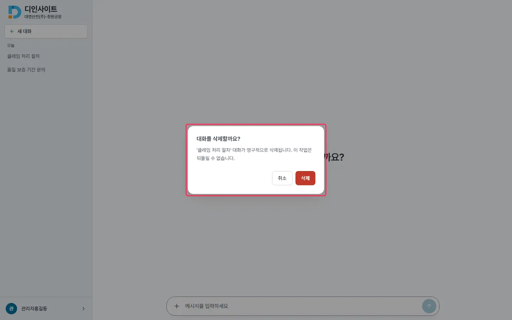 | 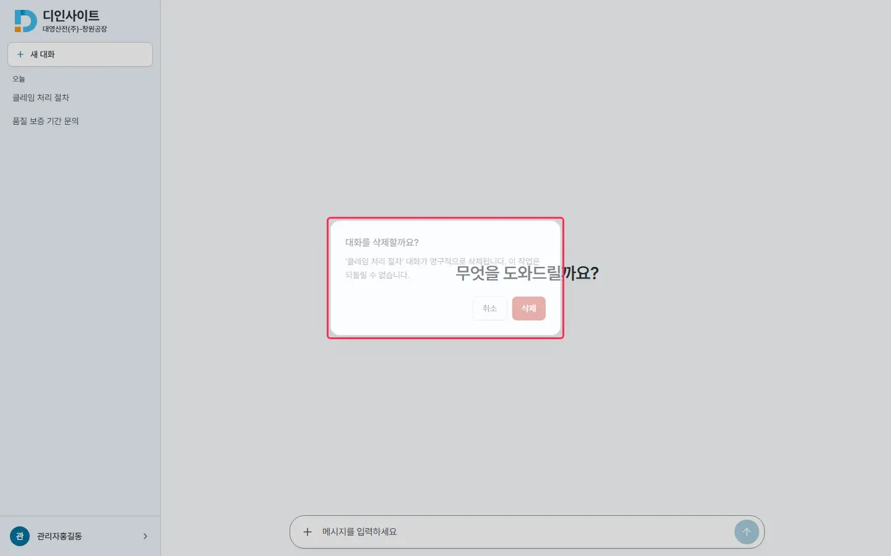 |
| 발급 창 열기 | 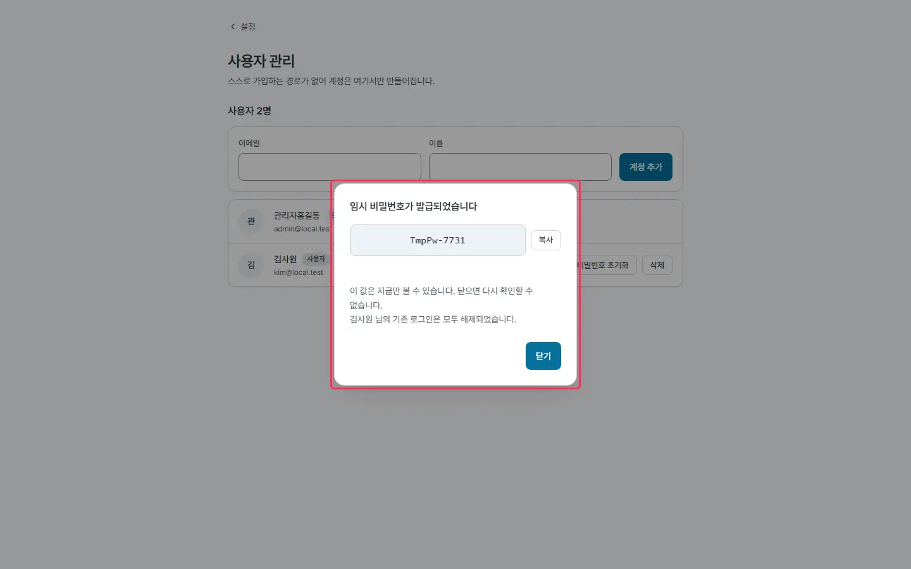 | 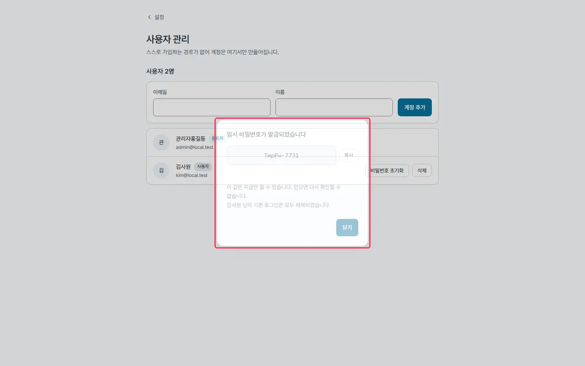 |
| 복사 알림 | 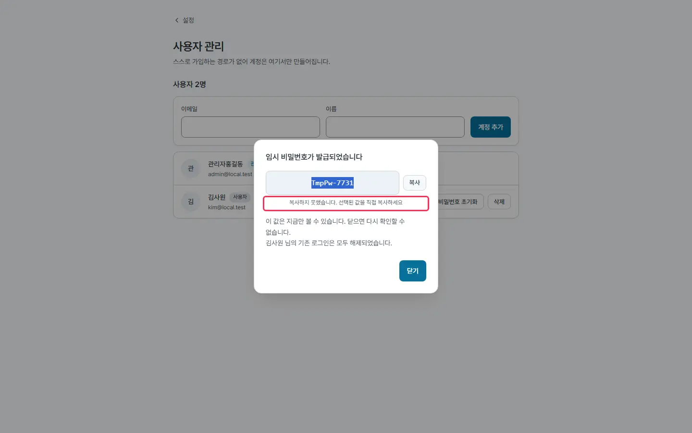 | 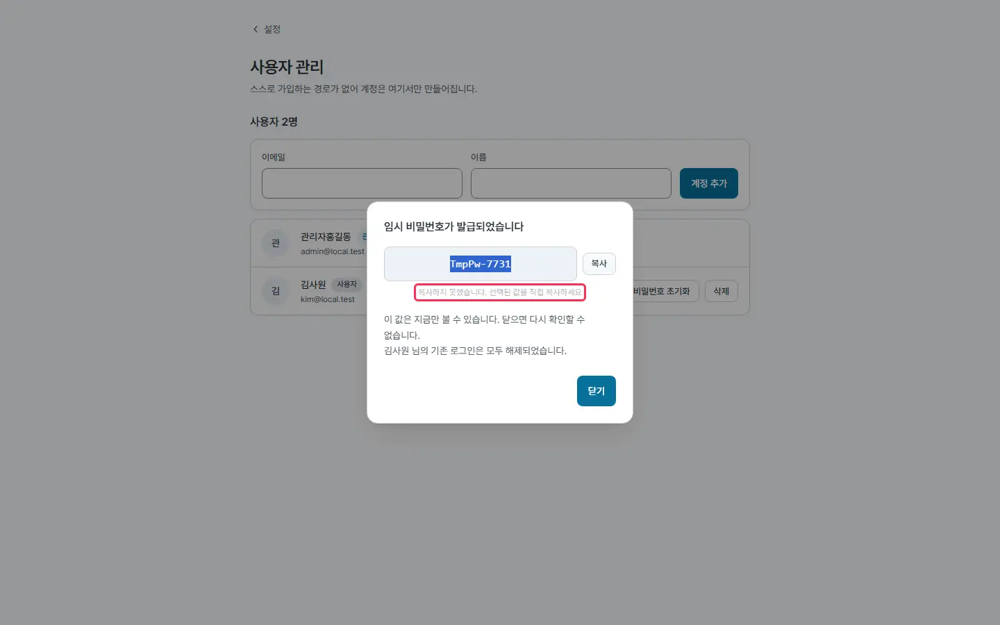 |
| 오류 배너 | 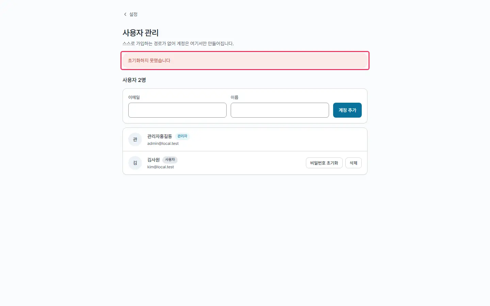 | 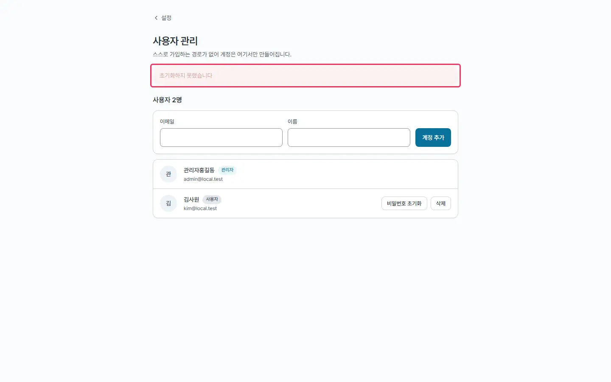 |
| 드로어(390) | 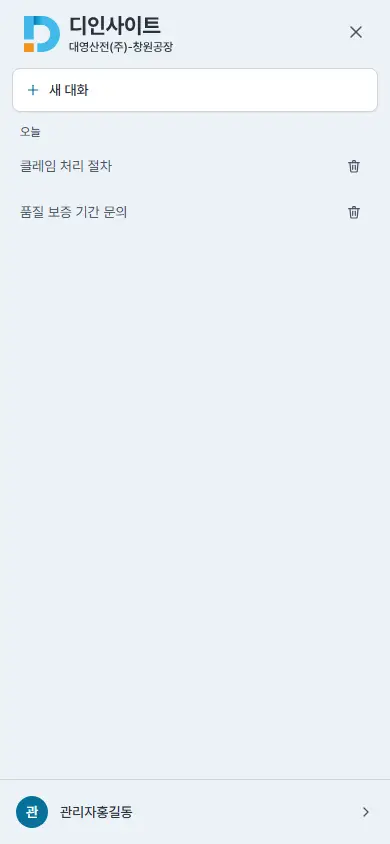 | 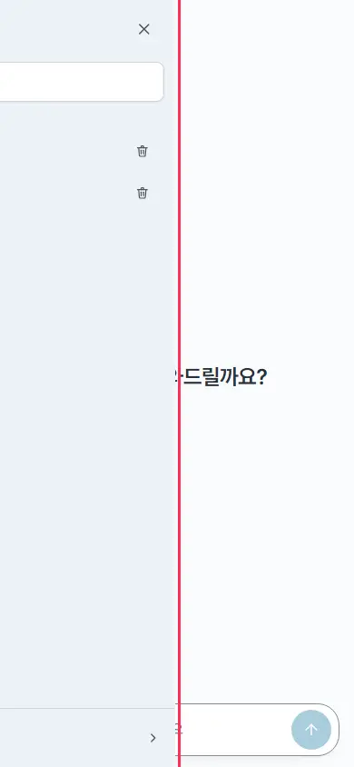 |
| 복사 알림(390) |  | 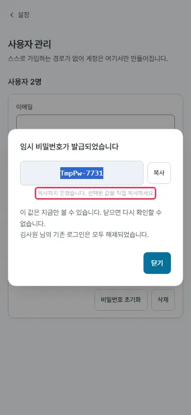 |

나머지 장면과 원자료는 `.issue/732/evidence/{before,after}/` 에 있습니다.

## 변경 파일

- `docs/02_architecture/design-system.md` §4 — 실측 줄을 측정 항목별로 다시 씀 · 속성 허용 목록에 개별 `scale` · `translate` · 알려진 동작 둘(라이트박스 늦은 이미지 · 블러 요소 Fade)
- `docs/06_changelog/CHANGELOG.md` — #730 항목 표기 · #732 항목
- `frontend/src/pages/AdminUsersPage.tsx` — 복사 알림 주석(다시 재생되는 이유는 먼저 비우기 #675, `key` 는 보험)

## 검증

- `bash scripts/check-all.sh docs` 통과 · 문서의 숫자를 probe.json 에서 스크립트로 다시 계산해 대조(처음 쓴 판에서 3곳이 어긋나 고침 : Layout 「15회 모두 같음」 · 레이아웃 시간 상한 · 스타일 하한)
- 하네스 실행 : `RUNS=15 FREEZE_MS=15 node e732.mjs <dist> <out> <playwright package.json>`

## 남은 것

- Layout +1 과 작업 증가의 나머지 몫(페인트 · 합성 추정)은 원인을 재지 않았습니다. 드로어의 레이아웃 시간은 두 측정에서 −0.3 / +3.7ms 로 흔들립니다
