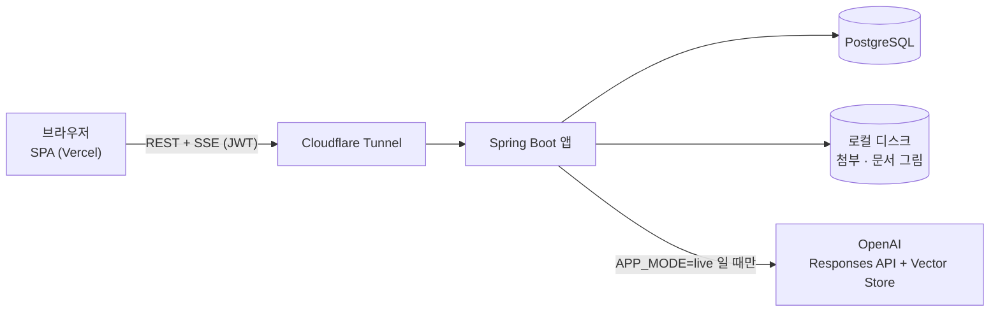

# rag-chatbot

사내 문서를 근거로 답하는 RAG 챗봇이다. OpenAI Responses API 에 공용 Vector Store 를 `file_search` 로 붙여 답하고,
답변에는 근거 자료의 출처를 항상 함께 보여 준다. 「자료 없음」 표시는 텍스트 접두가 아니라 **출처 0건에서 파생**한다 —
자료가 없으면 그 사실을 밝힌 뒤 추론으로 답한다. 질문에 첨부한 이미지는 모델의 비전 입력으로 전달된다.

> **데모** — https://rag-chatbot-jade-pi.vercel.app
> 가입 화면은 없다. **계정은 관리자가 발급**하므로 계정 없이는 로그인 화면까지만 볼 수 있다.

## 주요 기능

**사용자**
- 이메일/비밀번호 로그인(가입 없음) · 마이페이지에서 이름 · 비밀번호 변경
- 대화 목록 · 이름 변경 · 삭제, 대화별 이력 저장과 재조회
- 이미지 첨부 — 기기 선택창 · 드래그앤드롭 · 붙여넣기. 고르는 즉시 올라가고 전송 전에 썸네일로 확인 · 확대 보기
  (jpeg · png · webp · gif, 이미지가 아닌 파일은 받지 않는다)
- 스트리밍 답변과 진행 단계 표시(분석 → 검색 → 생성) · 정지 버튼(받은 데까지 저장)
- 출처 각주와 근거 스니펫 · 근거 문서에 관련 그림이 있으면 답변에 그림을 함께 표시

**관리자**
- 사내 문서를 제품 안에서 공용 Vector Store 에 업로드 · 삭제 · 스토어와 동기화(누가 언제 했는지 기록 · 인덱싱 실패 표시)
- 계정 발급(허용 이메일 도메인만) · 비밀번호 초기화

**운영**
- 사용자별 분당 상한 — 채팅 20 · 업로드 30 · 비밀번호 변경 5 · 로그인 10(계정별)
- 동시 채팅 스트림 상한 — 전역 16 · 사용자당 1(초과는 429)
- `APP_MODE=mock` 이면 OpenAI 호출 없이 전 경로가 목업 응답으로 돈다
- 턴별 토큰 사용량 기록 · 요청 상관 ID · 고아 첨부 회수

기본값의 정본은 `backend/.env.example` 이다.

## 구조

```
frontend/   React SPA (Vercel 배포)
backend/    Spring Boot API · Flyway 마이그레이션 · Dockerfile
scripts/    품질 게이트 · 배포 스크립트 · 문서 그림 · 클레임 전처리
docs/       명세 · 아키텍처 · 태스크 · 변경 이력 (진입점 docs/INDEX.md)
```



백엔드는 단일 인스턴스 전제다 — 레이트리밋 · 동시 스트림 카운터가 인메모리다.

## 기술 스택

| 영역 | 스택 |
|------|------|
| Frontend | React 19.2 · TypeScript 6.0 · Vite 8.1 · React Router 8.3 · Tailwind CSS 4.3 · react-markdown |
| Backend | Java 17 · Spring Boot 4.1.1 · Spring Security · MyBatis 4.1.0 · Flyway 12.4 |
| Database | PostgreSQL 16 (운영 compose 이미지 `postgres:16-alpine`, 다이제스트 고정) |
| 외부 연동 | OpenAI Responses API + Vector Store · 모델은 `OPENAI_MODEL`(기본 `gpt-6-sol`) |
| 테스트 | 백엔드 JUnit 6 + Testcontainers 2.0(실 PostgreSQL) · 프론트 Vitest 4.1 + Testing Library |
| Lint | oxlint 1.75 (프론트) |

툴체인 고정 : Node 는 `.nvmrc`(24) · Maven 은 Wrapper(`backend/mvnw`, 3.9.16)로 로컬과 CI 가 같은 버전을 쓴다.
**도커 이미지 빌드만 `mvnw` 대신 `maven:3.9.16-eclipse-temurin-17-alpine` 을 쓴다** — wrapper 는 빌드마다 Maven 배포판을
Maven Central 에서 내려받아, 그 요청이 거절되면 이미지 빌드가 통째로 멎기 때문이다(같은 3.9.16 이라 버전은 갈리지 않는다).

## 로컬 실행

환경변수 전량과 빠뜨렸을 때의 증상은 `.env.example` 파일 셋이 정본이다 —
`backend/.env.example`(앱) · `.env.example`(compose 의 DB 자격) · `frontend/.env.example`(프론트).

| 변수 | 쓰임 |
|------|------|
| `APP_MODE` | `mock` \| `live`. **기본값이 없어** 비우면 기동에 실패한다 |
| `JWT_SECRET` | 32바이트 이상. 짧거나 비면 기동에 실패한다 |
| `OPENAI_API_KEY` · `OPENAI_VECTOR_STORE_ID` · `OPENAI_MODEL` | `live` 에서만. 모델 기본값 `gpt-6-sol`. 스토어 ID 를 비우면 출처가 늘 0건(전부 「자료 없음」) |
| `ALLOWED_EMAIL_DOMAINS` | 계정을 만들 수 있는 도메인. **`live` 에서는 필수** |
| `ADMIN_EMAILS` | 관리자 명단. 계정이 없는 주소는 기동 시 만들어지고 임시 비밀번호가 로그에 한 번 찍힌다 |
| `ALLOWED_ORIGINS` | CORS 허용 출처. 기본값은 `http://localhost:5173` 하나뿐이다 |
| `VITE_API_BASE_URL` | 프론트가 부를 백엔드 주소. 빌드 시점에 번들에 박힌다 |

**목업 모드**(OpenAI 키 불필요)는 `APP_MODE=mock` · `JWT_SECRET` · `DB_*` 만 있으면 된다.
**실 연동 모드**는 여기에 `APP_MODE=live` · `OPENAI_API_KEY` · `OPENAI_VECTOR_STORE_ID` · `ALLOWED_EMAIL_DOMAINS` 를 더한다.

백엔드 — 둘 중 하나로 띄운다 :

```bash
# 1) Maven Wrapper — backend/.env 를 읽지 않는다. 환경변수를 셸에 직접 넣는다.
#    PostgreSQL 이 localhost:5432 에 있어야 한다(compose 의 db 는 호스트에 포트를 열지 않는다)
cd backend && ./mvnw spring-boot:run          # http://localhost:8080

# 2) docker compose — backend/.env 와 루트 .env(POSTGRES_PASSWORD)를 읽는다.
#    본체에 build 키가 없어 로컬 빌드는 override 를 겹친다
docker compose -f docker-compose.yml -f docker-compose.build.yml up -d --build db app
```

compose 는 app 에 `prod` 프로필을 기본으로 켜고, `prod` + `APP_MODE=mock` 조합은 기동을 막는다.
compose 로 목업을 띄울 때만 `SPRING_PROFILES_ACTIVE=` 로 비운다.

프론트 :

```bash
cd frontend && npm ci && npm run dev          # http://localhost:5173
```

CORS 기본값이 5173 하나라 다른 포트로 띄우면 `ALLOWED_ORIGINS` 를 함께 바꿔야 한다.

## 테스트와 CI

```bash
cd backend && ./mvnw verify                   # 테스트 + 빌드 (Testcontainers 라 Docker 필요)
cd frontend && npm run lint && npm test && npm run build
bash scripts/check-all.sh                     # CI 가 돌리는 검사를 푸시 전에 로컬에서 예행
```

케이스 수 하한은 `scripts/case-floors.env` 가 잠그고 `scripts/check-case-floor.sh` 가 검사한다 —
테스트 수가 하한 아래로 줄면 CI 가 실패한다. `bash scripts/check-all.sh docs` 는 문서 검사만 돌린다.

GitHub Actions(`.github/workflows/ci.yml`)는 변경마다 7잡을 전부 돌린다 :

| 잡 | 하는 일 |
|----|---------|
| `backend` | `mvnw verify` · 케이스 수 하한 · 런타임/문서 버전 대조 |
| `frontend` | 런타임 버전 대조(node) · oxlint · Vitest · tsc + vite 빌드 · 케이스 수 하한 |
| `docker` | 백엔드 이미지 빌드(푸시 없음) |
| `static` | 셸 구문 · shellcheck · DTO · resultMap · 프론트 타입 필드 대조 · 병합 충돌 표시 · 문서 참조 · 섹션 이름 |
| `secrets` | gitleaks 시크릿 스캔 |
| `deps-backend` | Trivy 의존성 취약점 스캔(`backend`) |
| `deps-frontend` | `npm audit --audit-level=high` 의존성 취약점 검사 |

`secrets` · `deps` 셋은 **주 1회 스케줄로도** 돈다 — 코드가 그대로여도 취약점 DB 가 바뀌면 답이 달라지기 때문이다.

## 배포 개요

- **프론트** — Vercel(Root Directory `frontend`, `main` 푸시 시 자동 배포). `VITE_API_BASE_URL` 은 빌드 시점에 박히므로
  값을 바꾸면 재배포해야 한다
- **백엔드** — 단일 서버 자체 호스팅. `docker-compose.yml` 로 앱 · PostgreSQL · cloudflared 세 컨테이너를 띄운다.
  Cloudflare Tunnel 이 바깥으로 연결을 걸어 **서비스 포트를 인바운드로 열지 않는다**(TLS 도 Cloudflare 가 종단)
- **이미지** — 서버는 빌드하지 않는다. `bash scripts/deploy.sh` 가 로컬에서 빌드해 서버로 옮겨 기동 · 헬스체크까지 한다
  (레지스트리 없음, 접속 대상은 `DEPLOY_HOST` 로 지정하며 기본값이 없다)
- **운영 가드** — compose 의 `prod` 프로필이 운영에서 목업 기동을 막는다. 백엔드 `ALLOWED_ORIGINS` 에 프론트 도메인을 넣는다
- **백업** — 서버 디스크 일일 스냅샷. 첨부 · DB · 문서 그림이 같은 디스크에 있다

절차와 근거는 `docs/02_architecture/backend.md` 「배포」 · `docs/02_architecture/frontend.md` 「배포 (Vercel)」에 있다.

## 문서

진입점은 [docs/INDEX.md](docs/INDEX.md) 다. 같은 사실은 한 곳에만 적는다.

| 문서 | 담는 것 |
|------|---------|
| [요구사항정의서](docs/01_specs/requirements.md) | `REQ-` ID 정본 |
| [기능명세서](docs/01_specs/features.md) | `FEAT-` ID · 처리 흐름 · 예외 · 범위 밖 |
| [ERD 설계서](docs/01_specs/erd.md) | 테이블 정의 · 인덱스 · 설계 원칙 · 사용량 조회 SQL |
| [API 명세서](docs/01_specs/api.md) | `API-` ID · 공통 규칙 · SSE 이벤트 · 에러 코드 |
| [OpenAI 실 연동 투입 절차](docs/01_specs/live-integration.md) | `mock` → `live` 전환과 비용 발생 지점 |
| [Architecture](docs/02_architecture/overview.md) | 시스템 구조 · 데이터 흐름 · 알려진 제약 |
| [Backend](docs/02_architecture/backend.md) | 레이어 · 인증 · SSE 계약 · 유량 제어 · 배포 |
| [Frontend](docs/02_architecture/frontend.md) | 라우팅 · 스트리밍 UI · 첨부 UI 계약 · 배포 |
| [디자인 시스템](docs/02_architecture/design-system.md) | 색 토큰 · 타이포 · 컴포넌트 규칙 |
| [Conventions](docs/CONVENTIONS.md) | 코드 스타일과 패턴 |
| [Changelog](docs/06_changelog/CHANGELOG.md) | 변경 이력 |

전체 목록은 `docs/INDEX.md` 에 있다.
